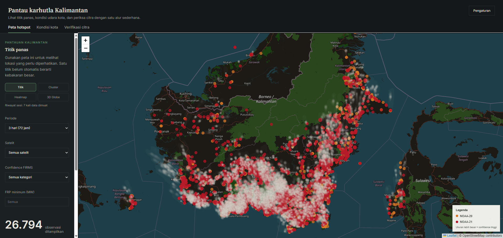

# Deteksi Dini Titik Panas (Wildfire WebGIS)


Aplikasi WebGIS untuk pemantauan potensi kebakaran hutan dan lahan (karhutla) di Kalimantan berbasis citra satelit dan prediksi Machine Learning.

> [!IMPORTANT]
> Aplikasi berjalan sepenuhnya di laptop sendiri. Tidak ada hosting berbayar, tidak ada Vercel, dan tidak ada Railway. Backend Flask menyajikan API sekaligus halaman React hasil build, lalu ngrok dipakai hanya bila penguji perlu membuka aplikasi dari perangkat lain. Panduan lengkap ada di [`docs/JALANKAN_LOKAL.md`](./docs/JALANKAN_LOKAL.md).

## Fitur Utama
* Pemetaan interaktif observasi titik panas di wilayah Kalimantan.
* Penarikan data titik api secara real-time dari satelit NASA FIRMS (VIIRS NRT).
* Kondisi cuaca dan AQI WAQI untuk 23 kota pantauan.
* Verifikasi pola citra dengan CNN RGB sebagai screening awal, bukan bukti kebakaran.

Dokumentasi training dan interpretasi hasil model tersedia di [`docs/MODEL_TRAINING.md`](./docs/MODEL_TRAINING.md).

## Tech Stack
* **Frontend:** React 19, Vite 8, Leaflet dan React-Leaflet, Recharts, CSS biasa
* **Backend:** Python 3.13, Flask, requests, python-dotenv
* **Inferensi:** TensorFlow/Keras 2.21, Pillow, NumPy, dijalankan sebagai proses Python terpisah (`backend/python/infer.py`)
* **Data eksternal:** NASA FIRMS (VIIRS NOAA-20/NOAA-21 NRT), OpenWeatherMap, WAQI
* **Publikasi demo:** ngrok, opsional dan gratis

## Cara Menjalankan di Lokal

### 1. Dependensi

```powershell
cd E:\Coding\wildfire-app
python -m pip install -r backend\requirements.txt
cd frontend
npm install
```

### 2. Kunci API

Salin `backend\.env.example` menjadi `backend\.env`, lalu isi `FIRMS_KEY`, `OWM_KEY`, dan `WAQI_KEY`. Berkas `.env` tidak ikut ke Git.

### 3. Build dan jalankan

```powershell
cd E:\Coding\wildfire-app
.\scripts\start-local.ps1
```

Skrip membangun frontend bila perlu, menyalakan Flask di `http://127.0.0.1:7860`, memeriksa `/api/health`, lalu membuka tunnel ngrok bila tersedia.

Tanpa skrip:

```powershell
cd frontend
npm run build
cd ..\backend
python app.py
```

### 4. Mode pengembangan frontend

```powershell
cd frontend
npm run dev
```

Buka `http://localhost:5173`. Frontend otomatis memanggil backend lokal di `http://127.0.0.1:7860`.

### 5. Demo lewat ngrok

```powershell
.\scripts\start-local.ps1 -Domain "nama-domain.ngrok-free.app"
```

Alamat publik dicetak di terminal dan diverifikasi otomatis. Laptop harus tetap menyala selama demo.

## Pemeriksaan

```powershell
cd backend
python -m unittest discover -s tests -t . -v

cd ..\frontend
npm run lint
npm run build
```

Model CNN berada di `backend\model\wildfire_model.h5` dengan 2.438.722 parameter. Hasil CNN adalah screening pola visual; aplikasi tidak memakainya sebagai penentu koordinat, ukuran api, atau bukti tunggal kebakaran.

## Request API

<pre>
1. <b>NASA FIRMS      :</b> <a href="https://firms.modaps.eosdis.nasa.gov/api/map_key" target="_blank">https://firms.modaps.eosdis.nasa.gov/api/map_key</a>
2. <b>OpenWeatherMap  :</b> <a href="https://openweathermap.org" target="_blank">https://openweathermap.org</a>
3. <b>WAQI            :</b> <a href="https://aqicn.org/api/" target="_blank">https://aqicn.org/api/</a>
</pre>

#
<p align="center">
  <sub>
    Proyek ini menggunakan referensi dari 
    <a href="https://www.kaggle.com/code/vidhuran07/wildfire-prediction-dataset-satellite-images" target="_blank">
      Wildfire Prediction Dataset (Satellite Images) - Kaggle
    </a> 
    untuk melatih model Machine Learning.
  </sub>
</p>
