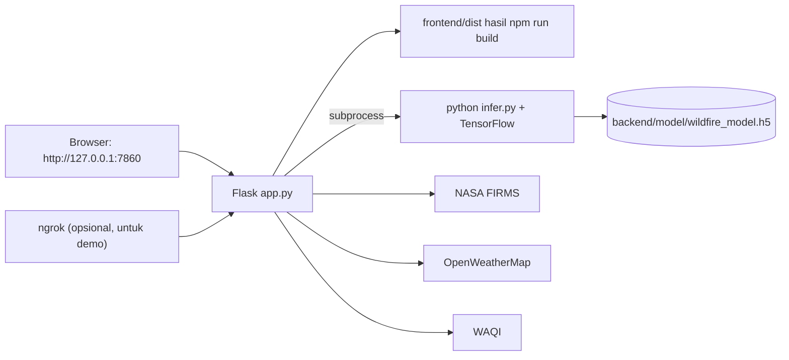

# Menjalankan Aplikasi Secara Lokal

Aplikasi ini berjalan sepenuhnya di laptop. Tidak ada hosting berbayar, tidak ada Vercel, tidak ada Railway. Backend Flask menyajikan API sekaligus hasil build frontend, sehingga aplikasi dibuka dari satu alamat saja.

## 1. Ringkasan arsitektur lokal



Satu proses Flask pada port `7860` menangani:

| Rute | Fungsi |
|---|---|
| `/` | Halaman aplikasi hasil build React |
| `/api/health` | Cek server hidup |
| `/api/model-status` | Cek file model CNN tersedia |
| `/api/hotspots` | Titik panas NASA FIRMS untuk 1–3 hari kalender UTC (cache 10 menit, otomatis kedaluwarsa saat tanggal UTC berganti) |
| `/api/wind` | Cuaca, angin, dan AQI 23 kota (cache 10 menit) |
| `/api/predict` | Unggah gambar, log inferensi streaming, lalu baris `RESULT:` |

## 2. Prasyarat

| Kebutuhan | Versi yang dipakai | Cek perintah |
|---|---|---|
| Python | 3.13 | `python --version` |
| Node.js | 20 atau lebih baru | `node --version` |
| ngrok | opsional | `ngrok --version` |

Dependensi Python terpasang global pada mesin pengembangan: Flask 3.1, requests, python-dotenv, NumPy, Pillow, TensorFlow 2.21.

## 3. Pasang dependensi

```powershell
cd E:\Coding\wildfire-app
python -m pip install -r backend\requirements.txt
cd frontend
npm install
```

## 4. Konfigurasi `backend/.env`

Salin `backend/.env.example` menjadi `backend/.env`, lalu isi tiga kunci API.

```text
FIRMS_KEY=...
OWM_KEY=...
WAQI_KEY=...
FRONTEND_ORIGINS=http://localhost:5173,http://127.0.0.1:7860
PORT=7860
HOST=127.0.0.1
PYTHON_BIN=python
RGB_MODEL_PATH=model/wildfire_model.h5
HOTSPOT_FETCH_TIMEOUT=90
```

| Variabel | Arti |
|---|---|
| `FIRMS_KEY` | Kunci map NASA FIRMS. Tanpa kunci ini `/api/hotspots` menjawab 503 |
| `OWM_KEY` | Kunci OpenWeatherMap untuk angin, suhu, dan AQI pembanding |
| `WAQI_KEY` | Kunci WAQI untuk AQI stasiun terdekat |
| `FRONTEND_ORIGINS` | Hanya dipakai saat mode dev, agar `localhost:5173` boleh memanggil API |
| `HOST` | `127.0.0.1` cukup untuk ngrok. Pakai `0.0.0.0` bila ingin diakses dari HP pada jaringan yang sama |
| `RGB_MODEL_PATH` | Lokasi file model, relatif terhadap folder `backend` |
| `HOTSPOT_FETCH_TIMEOUT` | Batas waktu satu permintaan CSV ke NASA FIRMS dalam detik (bawaan `90`). Naikkan bila unduhan FIRMS lambat |

File `.env` tidak ikut ke Git. Jangan pernah menaruh kunci API di kode atau di dokumen.

## 5. Menjalankan aplikasi

### 5.1 Cara cepat

```powershell
cd E:\Coding\wildfire-app
.\scripts\start-local.ps1
```

Skrip akan membangun frontend bila `frontend\dist` belum ada, menyalakan Flask, menunggu `/api/health`, lalu membuka tunnel bila ngrok tersedia.

| Parameter | Kegunaan |
|---|---|
| `-Port 8080` | Ganti port Flask |
| `-Build` | Paksa `npm run build` sebelum server dinyalakan |
| `-NoTunnel` | Hanya lokal, tanpa ngrok |
| `-Domain "xxxx.ngrok-free.app"` | Pakai domain tetap ngrok |

### 5.2 Manual

```powershell
cd E:\Coding\wildfire-app\frontend
npm run build
cd ..\backend
python app.py
```

Buka `http://127.0.0.1:7860`. Semua rute API berada di alamat yang sama, jadi tidak ada masalah CORS.

Frontend memakai alamat halaman itu sendiri sebagai alamat API, sehingga `frontend\.env` tidak perlu dibuat. Bila tetap dibuat, `VITE_API_URL` harus berupa URL biasa seperti `VITE_API_URL=http://127.0.0.1:7860` tanpa tanda kurung atau teks tambahan, lalu `npm run build` dijalankan ulang. Nilai yang tidak valid diabaikan, dan frontend kembali memakai alamat halaman.

### 5.3 Mode pengembangan

```powershell
cd E:\Coding\wildfire-app\frontend
npm run dev
```

Buka `http://localhost:5173`. Karena `import.meta.env.DEV` bernilai benar, frontend otomatis memanggil `http://127.0.0.1:7860`. Flask mengizinkan origin `5173` lewat `FRONTEND_ORIGINS`.

## 6. Tunnel ngrok untuk demo

Tunnel dipakai saat penguji harus membuka aplikasi dari perangkat lain, misalnya dosen atau penguji sidang.

### 6.1 Sekali saja

```powershell
winget install ngrok.ngrok
ngrok config add-authtoken TOKEN_DARI_DASHBOARD
```

Token diambil dari `https://dashboard.ngrok.com/get-started/your-authtoken`. Setelah instalasi, buka terminal baru agar perintah `ngrok` dikenali.

### 6.2 Setiap demo

```powershell
cd E:\Coding\wildfire-app
.\scripts\start-local.ps1 -Domain "nama-domain.ngrok-free.app"
```

Akun ngrok gratis memberi satu domain statis. Isi `nama-domain` sesuai halaman **Domains** di dashboard, sehingga alamat demo tidak berubah setiap kali server dinyalakan.

Tanpa domain statis, jalankan tanpa `-Domain`. Alamat publik berubah setiap restart dan terbaca di `http://127.0.0.1:4040`.

### 6.3 Header peringatan ngrok

Ngrok gratis menampilkan halaman peringatan sebelum meneruskan permintaan API. Frontend mengirim header `ngrok-skip-browser-warning: 1` secara otomatis bila `VITE_API_URL` atau alamat halaman mengandung `ngrok`. Tidak ada pengaturan tambahan yang diperlukan.

### 6.4 Batas paket gratis

| Batas | Nilai |
|---|---|
| Permintaan | 20.000 per bulan |
| Transfer data | 1 GB per bulan |
| Endpoint bersamaan | 3 |
| Domain statis | 1 |
| Batas waktu koneksi | tidak ada |

Laptop harus tetap menyala dan terhubung internet selama demo. Bila penguji hanya duduk di depan laptop yang sama, `-NoTunnel` lebih hemat kuota.

## 7. Verifikasi setelah server jalan

```powershell
curl.exe -s http://127.0.0.1:7860/api/health
curl.exe -s http://127.0.0.1:7860/api/model-status
curl.exe -s "http://127.0.0.1:7860/api/hotspots?days=1"
curl.exe -s http://127.0.0.1:7860/api/wind
curl.exe -s -X POST -F "image=@docs\assets\01-contoh-citra-dua-kelas.png" http://127.0.0.1:7860/api/predict
```

Hasil yang diharapkan:

| Rute | Tanda berhasil |
|---|---|
| `/api/health` | `{"status":"ok"}` |
| `/api/model-status` | `"ready":true` |
| `/api/hotspots` | `"total"` lebih dari nol dan `"sources"` berisi dua produk `available` |
| `/api/wind` | `grid` berisi 23 kota dengan `windSpeed` dan `airQuality` |
| `/api/predict` | Baris log bertahap, diakhiri `RESULT:{...}` dengan `parameters: 2438722` |

Uji lewat tunnel dengan menambahkan header:

```powershell
curl.exe -s -H "ngrok-skip-browser-warning: 1" https://nama-domain.ngrok-free.app/api/health
```

## 8. Batasan mode lokal

| Hal | Dampak |
|---|---|
| Laptop harus hidup | Aplikasi mati saat laptop tidur atau terminal ditutup |
| TensorFlow dimuat tiap prediksi | Baris log pertama muncul seketika, tetapi hasil butuh sekitar 15 sampai 20 detik karena `infer.py` dijalankan sebagai proses baru |
| Kuota ngrok gratis | 20.000 permintaan per bulan, cukup untuk demo |
| Data FIRMS bergantung internet | Bila NASA tidak dapat dihubungi, endpoint menjawab 502 dan memakai cache terakhir bila ada |
| Tidak ada HTTPS lokal | Tunnel ngrok sudah menyediakan HTTPS |

## 9. Pemecahan masalah

| Gejala | Penyebab | Tindakan |
|---|---|---|
| `Frontend belum dibangun` | `frontend/dist` tidak ada | `cd frontend; npm run build` |
| Semua tab kosong padahal `/api/health` menjawab `ok` | `frontend\.env` berisi `VITE_API_URL` salah, atau `frontend\dist` masih hasil build lama | Hapus `VITE_API_URL` di `frontend\.env`, lalu `npm run build` di folder `frontend` |
| `FIRMS_KEY belum dikonfigurasi` | `backend/.env` kosong atau salah nama | Isi `FIRMS_KEY` lalu restart Flask |
| Halaman ngrok menampilkan peringatan | Header belum terkirim | Pastikan membuka aplikasi lewat alamat ngrok, bukan `127.0.0.1` |
| `Address already in use` | Port 7860 dipakai proses lain | `.\scripts\start-local.ps1 -Port 8080` |
| Log prediksi kosong lalu `ERROR` | TensorFlow gagal dimuat | Jalankan `python backend\python\infer.py gambar.jpg` untuk melihat galat asli |
| `Upload gambar tidak valid` | File melebihi 5 MB | Kompres gambar terlebih dahulu |
| Terlalu banyak permintaan | Batas 10 prediksi per menit | Tunggu satu menit |

## 10. Daftar periksa sebelum demo

1. `python -m unittest discover -s tests -t .` di folder `backend` menghasilkan 6 tes lolos.
2. `npm run build` di folder `frontend` selesai tanpa galat.
3. `.\scripts\start-local.ps1 -Domain "xxxx.ngrok-free.app"` mencetak URL publik dan `Verifikasi ... OK`.
4. Tiga tab aplikasi dibuka: Peta hotspot, Kondisi kota, Verifikasi citra.
5. Satu gambar uji sudah disiapkan di folder yang mudah dijangkau, ukuran di bawah 5 MB.
6. Laptop diatur agar tidak tidur selama presentasi.

