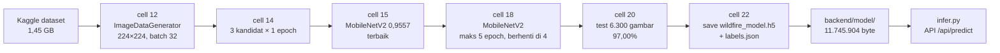
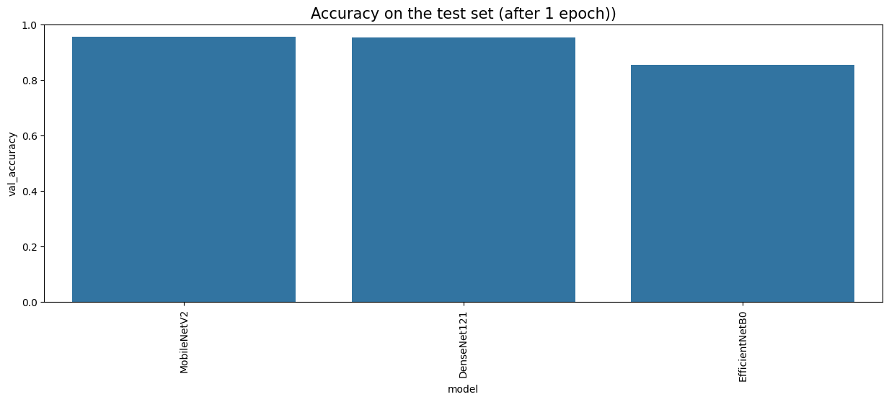
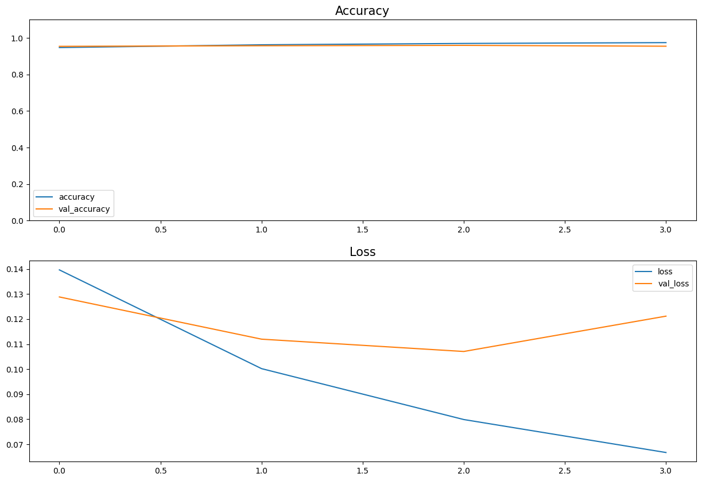
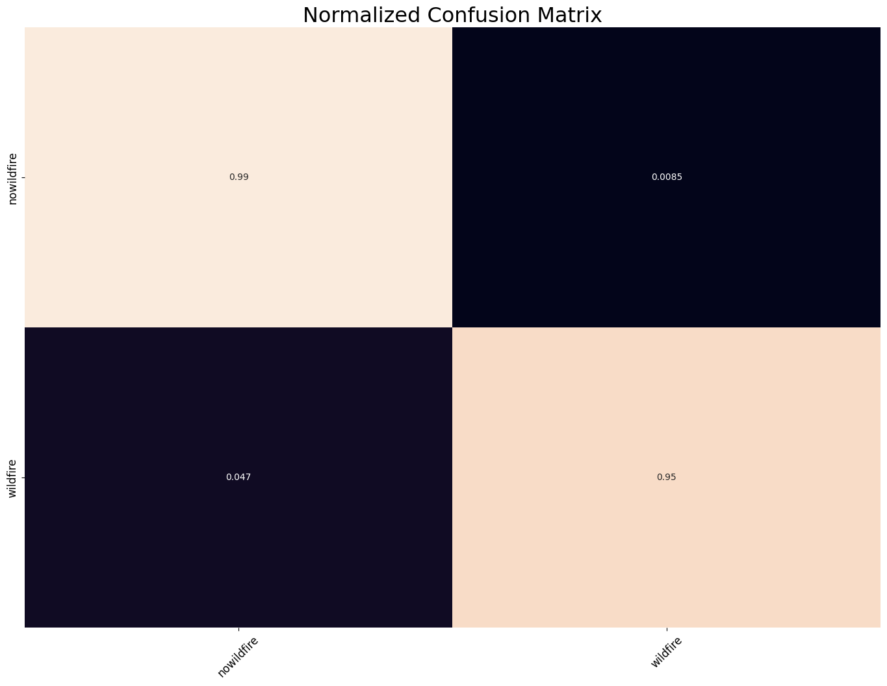

# Dokumentasi Training Model Klasifikasi Citra Wildfire

Dokumen ini menjelaskan **bagaimana model CNN yang dipakai aplikasi benar-benar dilatih**, bukan bagaimana seharusnya dilatih. Semua angka diambil dari output yang tersimpan di notebook pelatihan dan dari pembacaan langsung file model.

Terakhir diverifikasi: **20 Oktober 2026**.

> **Ringkasan satu paragraf.** Model yang dipakai aplikasi adalah **MobileNetV2** hasil transfer learning. Notebook membandingkan **tiga** arsitektur selama satu epoch; MobileNetV2 menang tipis dengan `val_accuracy` **0,9557**, lalu dilatih ulang maksimal lima epoch dengan EarlyStopping dan berhenti di epoch keempat. Akurasi pada test set yang tercatat adalah **97,00%** untuk MobileNetV2. Angka itu sah untuk artefak yang disimpan, karena evaluasi test dilakukan pada model yang bobotnya sudah dipulihkan ke epoch terbaik, dan objek model yang sama itu yang kemudian di-`save()`.

---

## 1. Sumber yang diverifikasi

| Peran | Objek | Keterangan |
|---|---|---|
| **Sumber utama** | Notebook Colab `wildfire-prediction-dataset-satellite-images.ipynb` | [colab.research.google.com/drive/1NX43x-kH59Qu_nabDKVnKekNh4h-w9Se](https://colab.research.google.com/drive/1NX43x-kH59Qu_nabDKVnKekNh4h-w9Se?usp=sharing), 29 cell, output tersimpan |
| **Artefak** | `backend/model/wildfire_model.h5` | 11.745.904 byte, Keras 3.13.2 |
| **Label** | `backend/model/labels.json` | 36 byte, `{0: nowildfire, 1: wildfire}` |
| **Kode inferensi** | `backend/python/infer.py` | pra-pemrosesan yang harus sama dengan saat training |
| **Pembanding, bukan sumber artefak** | Notebook Kaggle `wildfire-prediction-dataset-satellite-images (1).ipynb` | 27 backbone, output lama; lihat §10 |

Waktu pelatihan notebook utama dapat dibaca dari output `ls -la` di cell 24: `Sep 27 19:33`. Ini bertepatan dengan tanggal berkas label dan model di repositori (`28 September 2026`), yang memperkuat bahwa kedua berkas berasal dari run yang sama.

## 2. Rantai provenance: artefak memang keluaran notebook ini

Ini bagian terpenting dokumen. Sebelumnya pernah ada kebingungan karena ada **dua** notebook dengan hasil berbeda. Tabel berikut menunjukkan bukti bahwa berkas `.h5` di repositori adalah keluaran notebook Colab di §1, bukan notebook 27 backbone.

| Bukti | Yang tercatat di notebook | Yang ada di repositori | Cocok |
|---|---|---|---|
| Ukuran berkas model | cell 24: `11745904` byte | `wildfire_model.h5` = 11.745.904 byte | ✅ |
| Isi label | cell 22: `{0: 'nowildfire', 1: 'wildfire'}` | `labels.json` 36 byte, isi identik | ✅ |
| Jumlah langkah optimizer | cell 18: 851 batch × 4 epoch = 3.404 | `optimizer_weights/adam/iteration = 3404` | ✅ |
| Arsitektur | cell 15 + 18: MobileNetV2 | `dense_9` 1.280→128, 158 layer | ✅ |
| Metrik test | cell 20: `97.00% accuracy on the test set` | tidak tersimpan di berkas, hanya di notebook | — |



Satu catatan kejujuran metodologis: kesamaan ukuran byte dan jumlah langkah optimizer adalah bukti yang sangat kuat, tetapi bukan bukti kriptografis, karena sidik jari berkas di Colab tidak dicatat di notebook. Bukti akan menjadi sempurna bila hash SHA-256 berkas Colab disimpan saat ekspor. Untuk keperluan dokumentasi proyek ini, rantai bukti di atas sudah memadai.

## 3. Dataset dan pembagian data

Dataset: Kaggle [`abdelghaniaaba/wildfire-prediction-dataset`](https://www.kaggle.com/datasets/abdelghaniaaba/wildfire-prediction-dataset), diunduh pada cell 0 dan diekstrak ke `/content/dataset` (1,45 GB).

| Split | Jumlah gambar | Dipakai untuk | Status |
|---|---|---|---|
| `train` | 30.250 | dipotong internal menjadi train + validation | dipakai |
| `test` | 6.300 | evaluasi akhir | dipakai |
| `valid` | 6.300 | — | **dimuat dan divisualisasikan, tidak dipakai** |

Pemotongan pada cell 12 memakai `ImageDataGenerator(validation_split=0.1)` dengan `seed=0`:

- **27.225** gambar untuk training (`subset='training'`), terbagi menjadi 851 batch berukuran 32.
- **3.025** gambar untuk validasi (`subset='validation'`).
- **6.300** gambar untuk test, dengan `shuffle=False` agar urutan prediksi sejajar dengan `df_test.Label`.

Total gambar yang benar-benar dipakai: **36.550 dari 42.850** (85,3%). Sebanyak 6.300 gambar pada folder `valid` tidak pernah dipakai, sehingga ada data berlabel yang terbuang.

Isi dataset: citra satelit berukuran asli 350×350 piksel dari area yang pernah terbakar di **Kanada** (Quebec), dengan nama berkas berupa koordinat, misalnya `-73.443249,4...jpg`. Dua kelas: `wildfire` dan `nowildfire`.

## 4. Pra-pemrosesan

Konfigurasi pada cell 12 dan 13:

| Parameter | Nilai |
|---|---|
| Ukuran input | 224×224 piksel |
| Color mode | RGB (3 kanal) |
| Normalisasi | `tf.keras.applications.mobilenet_v2.preprocess_input` → skala [-1, 1] |
| Batch size | 32 |
| Mode label | `categorical` (one-hot, 2 kelas) |
| Loss | `categorical_crossentropy` |
| Optimizer | Adam, learning rate default 0,001 (terbaca di artefak) |

### 4.1 Augmentasi tidak pernah berjalan

Parameter `rotation_range=30`, `zoom_range=0.15`, `width_shift_range=0.2`, `height_shift_range=0.2`, `shear_range=0.15`, `horizontal_flip=True`, dan `fill_mode="nearest"` ditulis di dalam pemanggilan **`flow_from_dataframe(...)`**.

Fungsi tersebut tidak memiliki parameter itu; argumen yang tidak dikenali hanya masuk ke `**kwargs` dan diabaikan tanpa peringatan. Akibatnya **model dilatih hanya dengan resize dan normalisasi**, tanpa augmentasi sama sekali.

Perbaikan yang benar:

```python
train_generator = tf.keras.preprocessing.image.ImageDataGenerator(
    preprocessing_function=tf.keras.applications.mobilenet_v2.preprocess_input,
    validation_split=0.1,
    rotation_range=30,
    zoom_range=0.15,
    width_shift_range=0.2,
    height_shift_range=0.2,
    shear_range=0.15,
    horizontal_flip=True,
    fill_mode="nearest",
)
```

### 4.2 Pra-pemrosesan berada di luar model

Model `.h5` **tidak memiliki layer `Rescaling`** di dalamnya. Layer pertama adalah `Conv2D` milik MobileNetV2, yang menerima tensor ternormalisasi. Konsekuensinya, siapa pun yang memakai model ini **wajib** memanggil `preprocess_input` yang sama sebelum prediksi. `backend/python/infer.py` sudah melakukannya; kalau langkah itu dilepas, akurasi akan turun drastis tanpa pesan error.

### 4.3 Catatan kecil

Generator validasi dibuat dengan `shuffle=True`. Ini tidak mengubah nilai `val_accuracy` agregat karena metrik dihitung atas seluruh batch, tetapi sebaiknya diubah menjadi `False` agar urutan prediksi validasi dapat diaudit.

## 5. Seleksi arsitektur: tiga kandidat

Cell 13 mendefinisikan satu resep transfer learning yang dipakai untuk semua kandidat:

```python
pretrained_model = model(input_shape=(224, 224, 3), include_top=False,
                         weights='imagenet', pooling='avg')
pretrained_model.trainable = False

x = tf.keras.layers.Dense(128, activation='relu')(pretrained_model.output)
x = tf.keras.layers.Dense(128, activation='relu')(x)
outputs = tf.keras.layers.Dense(2, activation='softmax')(x)
```

Backbone **dibekukan seluruhnya** (`trainable = False`); yang dilatih hanya tiga layer Dense di atasnya.

Cell 14 melatih tiga arsitektur selama **satu epoch** dengan `validation_data=val_images`:

| Peringkat | Model | `val_accuracy` (1 epoch) | Waktu training |
|---|---|---|---|
| 1 | **MobileNetV2** | **0,9557** | 115,66 detik |
| 2 | DenseNet121 | 0,9534 | 150,70 detik |
| 3 | EfficientNetB0 | 0,8555 | 125,07 detik |



Kolom terakhir pada tabel `df_results` di notebook: MobileNetV2 0,9557 (115,66 s), DenseNet121 0,9534 (150,70 s), EfficientNetB0 0,8555 (125,07 s).

### 5.1 Dua catatan yang harus disebut saat presentasi

1. **Selisih MobileNetV2 dan DenseNet121 sangat tipis**, yaitu 0,0023 atau sekitar 7 gambar dari 3.025 gambar validasi. Ini belum cukup untuk menyimpulkan MobileNetV2 lebih unggul secara meyakinkan; keunggulannya yang sebenarnya adalah **kecepatan** dan ukuran model yang jauh lebih kecil.
2. **Perbandingan ini bias ke MobileNetV2.** Semua kandidat memakai `mobilenet_v2.preprocess_input`, padahal setiap arsitektur punya skema normalisasi ImageNet-nya sendiri. EfficientNetB0 punya layer normalisasi internal dan mengharapkan skala 0–255, sehingga menerima input [-1, 1] membuat performanya jatuh ke 0,8555. Angka itu mencampur kualitas arsitektur dengan ketidakcocokan pra-pemrosesan, jadi tidak boleh dibaca sebagai "EfficientNetB0 buruk".

Judul grafik batang di cell 16 berbunyi *"Accuracy on the test set (after 1 epoch)"*, padahal sumbu Y-nya adalah `val_accuracy` dari 3.025 gambar validasi, bukan test set. Tidak ada test set yang dievaluasi pada tahap ini.

## 6. Training model final

Cell 18 membangun ulang MobileNetV2 dari nol, lalu melatihnya dengan batas lima epoch, `EarlyStopping(monitor='val_loss', patience=1, restore_best_weights=True)`, dan tanpa `ModelCheckpoint`. Pelatihan berhenti sendiri di epoch keempat karena `val_loss` naik:

| Epoch | Train accuracy | Train loss | Val accuracy | Val loss |
|---|---|---|---|---|
| 1 | 0,9474 | 0,1397 | 0,9540 | 0,1288 |
| 2 | 0,9626 | 0,1002 | 0,9574 | 0,1120 |
| 3 | 0,9698 | 0,0799 | **0,9593** | **0,1071** ← terbaik |
| 4 | 0,9744 | 0,0667 | 0,9547 | 0,1212 |



Yang perlu dipahami dari tabel ini:

- **Epoch terbaik adalah epoch 3** menurut `val_loss`. Karena `restore_best_weights=True`, bobot yang dipakai setelah `fit()` selesai adalah bobot **epoch 3**, bukan epoch 4.
- Train accuracy terus naik sampai 0,9744 sementara val accuracy turun di epoch 4. Ini gejala **overfitting ringan** pada akhir pelatihan, dan itulah alasan EarlyStopping menghentikan proses.
- Empat epoch yang berjalan cocok dengan `optimizer/iteration = 3404` pada artefak (851 × 4). Jadi artefak disimpan setelah empat epoch berjalan, dengan bobot yang sudah dipulihkan ke epoch 3.

## 7. Evaluasi pada test set

Cell 20 memprediksi seluruh 6.300 gambar test (197 batch) memakai objek `model` yang bobotnya sudah dipulihkan ke epoch 3:

```python
pred = model.predict(test_images)
acc = accuracy_score(list(df_test.Label), pred_labels)
printmd(f'## Best Model: {best_model[0]} with {acc*100:.2f}% accuracy on the test set')
```

Output yang tersimpan:

> `## Best Model: MobileNetV2 with 97.00% accuracy on the test set`

Angka **97,00%** berarti **6.111 benar dan 189 salah** dari 6.300 gambar. Karena evaluasi memakai bobot epoch 3 yang sama dengan yang disimpan di cell 22, angka ini **sah dikutip untuk model yang dipakai aplikasi**.

Cell yang sama juga menampilkan **confusion matrix ternormalisasi**:



Yang **tidak** ada di notebook:

| Metrik | Status |
|---|---|
| Accuracy test | ✅ 97,00% (MobileNetV2) |
| Confusion matrix | ✅ ada, tetapi hanya sebagai gambar; angkanya tidak dicetak sebagai teks |
| Precision, recall, F1 per kelas | ❌ `classification_report` diimpor di cell 2 tetapi **tidak pernah dipanggil** |
| Kurva ROC / AUC | ❌ tidak ada |
| Kalibrasi skor softmax | ❌ tidak ada |
| Evaluasi folder `valid` | ❌ tidak pernah dihitung |

Tanpa precision dan recall per kelas, belum bisa dijawab pertanyaan "lebih berbahaya mana, kebakaran yang lolos atau gambar bersih yang dituduh terbakar?". Confusion matrix pada gambar menunjukkan kedua jenis kesalahan ada, tetapi angka pastinya baru bisa dikutip setelah sel evaluasi dijalankan ulang (§11).

Cell 21 menampilkan 24 contoh prediksi beserta label aslinya, tetapi Colab menyimpannya sebagai *"Output hidden; open in colab.research.google.com to view"*, sehingga galat kualitatif tidak dapat diperiksa dari berkas notebook.

## 8. Artefak deployment

Hasil pembacaan `backend/model/wildfire_model.h5`:

| Atribut | Nilai |
|---|---|
| Format | HDF5 (`.h5`), format legacy Keras 3 |
| Keras | 3.13.2, backend TensorFlow |
| Tipe model | Functional |
| Jumlah layer | 158 |
| Total parameter | 2.438.722 |
| Backbone | MobileNetV2, **seluruhnya frozen**, 2.257.984 parameter |
| Head terlatih | 180.738 parameter (`Dense` 1.280→128 = 163.968, `Dense` 128→128 = 16.512, `Dense` 128→2 = 258) |
| Head | `GlobalAveragePooling` → `Dense(128, relu)` → `Dense(128, relu)` → `Dense(2, softmax)` |
| Isi berkas | bobot **dan** state optimizer (`optimizer_weights/adam`, `iteration = 3404`, `learning_rate = 0,001`) |
| Input | `float32` 224×224×3, rentang [-1, 1] |
| Output | 2 nilai softmax, indeks 0 = `nowildfire`, 1 = `wildfire` |

Angka backbone itu bukti tambahan arsitektur: MobileNetV2 tanpa top layer berukuran tepat 2.257.984 parameter, sedangkan MobileNet V1 berukuran sekitar 3,2 juta. Karena `trainable = False`, seluruh parameter backbone bersifat tetap dan hanya 180.738 parameter head yang berubah saat training. Ini menjelaskan mengapa berkas hanya 11,7 MB dan mengapa inferensi di CPU masih di bawah satu detik.

Model disimpan dengan `model.save()` yang memunculkan peringatan Keras: *"This file format is considered legacy. We recommend using instead the native Keras format"*. Format `.h5` tetap berfungsi, tetapi `.keras` lebih tepat untuk pekerjaan berikutnya.

## 9. Keterbatasan dan temuan audit

Diurutkan dari yang paling perlu ditindaklanjuti:

1. **Token API Kaggle tertulis terbuka di cell 0** (`os.environ["KAGGLE_API_TOKEN"] = "KGAT_..."`). Siapa pun yang membuka notebook dapat membacanya. Token harus **dicabut dan dibuat ulang**, lalu disimpan di Colab Secrets, bukan di dalam cell.
2. **Augmentasi tidak aktif** (§4.1), sehingga model lebih rentan terhadap variasi rotasi, skala, dan pencahayaan.
3. **Seleksi arsitektur hanya 1 epoch dan pra-pemrosesan tidak disesuaikan per model** (§5), sehingga perbandingan belum sepenuhnya adil.
4. **Precision, recall, dan F1 belum tersedia** (§7). Untuk aplikasi yang menampilkan "terlihat seperti area terbakar", biaya false positive dan false negative perlu diketahui.
5. **Konversi ONNX gagal.** Cell 27 memasang `tf2onnx` lalu konversi berhenti dengan `VersionError: Detected incompatible Protobuf Gencode/Runtime versions ... gencode 6.31.1 runtime 5.29.6`. Tidak ada berkas `.onnx` di repositori, dan backend saat ini memakai Python + TensorFlow, bukan ONNX.
6. **Domain data adalah Kanada, bukan Kalimantan** (Quebec, 350×350 px). Tidak ada contoh negatif dari lahan gambut, kabut asap, atau tutupan awan tropis. Model hanya sah sebagai demonstrasi metode.
7. **Folder `valid` (6.300 gambar) tidak dipakai**, padahal bisa menjadi validasi eksternal yang lebih jujur daripada potongan 10% dari train.
8. **Skor softmax belum dikalibrasi**, jadi angka "98%" bukan probabilitas kebakaran.

## 10. Notebook pembanding: 27 backbone

Ada notebook lain di mesin pengembang, `wildfire-prediction-dataset-satellite-images (1).ipynb`, yang membandingkan **27 backbone** pada dataset yang sama. Notebook itu **bukan** sumber artefak yang dipakai aplikasi, tetapi berguna sebagai eksplorasi awal.

Cuplikan hasilnya:

| Posisi | Model | `val_accuracy` (1 epoch) |
|---|---|---|
| 1 | MobileNet (V1) | 0,9640 |
| 2 | DenseNet201 | 0,9636 |
| 3 | DenseNet169 | 0,9600 |
| 8 | MobileNetV2 | 0,9544 |
| 19 | EfficientNetB7 | 0,8506 |

Catatan pada notebook pembanding:

- Notebook ini melaporkan test accuracy **97,86%**, tetapi untuk **MobileNet V1**, bukan untuk MobileNetV2. Angka itu tidak boleh dipakai untuk model aplikasi.
- Terdapat nama model duplikat di dictionary sehingga jumlah kandidat unik kurang dari 27.
- `EfficientNetB5`, `B6`, dan `B7` memakai bobot `EfficientNetB4` karena tidak tersedia di Keras Applications, sehingga barisnya tidak mewakili arsitektur yang tertulis.
- Semua kandidat juga memakai `mobilenet_v2.preprocess_input`, sehingga masalah bias pra-pemrosesan pada §5.1 berlaku sama.

Karena itu, dokumen ini memakai notebook Colab 3 kandidat sebagai acuan: notebook itulah yang menghasilkan berkas yang benar-benar dipakai aplikasi.

## 11. Cara mereproduksi dan mengukur ulang

Untuk mengukur accuracy, precision, recall, F1, dan confusion matrix dengan angka yang bisa dikutip, jalankan setelah cell 20 pada notebook (butuh dataset 1,45 GB):

```python
from sklearn.metrics import classification_report, confusion_matrix

y_true = list(df_test.Label)
y_pred = pred  # hasil mapping dari cell 20

print(classification_report(y_true, y_pred, digits=4))
print(confusion_matrix(y_true, y_pred, labels=sorted(set(y_true))))
```

Perintah yang sama dapat dijalankan pada lingkungan lokal:

```powershell
cd backend
python -c "import tensorflow as tf; m = tf.keras.models.load_model('model/wildfire_model.h5'); m.summary()"
```

Untuk melatih ulang dari nol, urutan notebook yang benar adalah: unduh dataset (cell 0) → buat DataFrame (cell 3) → perbaiki augmentasi ke konstruktor generator (§4.1) → latih kandidat dengan jumlah epoch yang setara dan pra-pemrosesan sesuai masing-masing arsitektur → pilih model → evaluasi pada `test` **dan** `valid` → simpan dengan `model.save('wildfire_model.keras')`.

## 12. Riwayat koreksi dokumen

Tabel ini disimpan agar pembaca yang menemukan versi lama dokumen memahami mengapa angkanya berubah.

| Klaim pada versi lama | Fakta setelah notebook Colab diverifikasi | Status |
|---|---|---|
| "27 backbone dibandingkan, MobileNet V1 menang 0,9640, MobileNetV2 peringkat 9" | Angka itu benar, tetapi berasal dari **notebook pembanding**. Notebook yang menghasilkan artefak memakai **3 kandidat** dan **MobileNetV2 menang 0,9557** | Diperbaiki |
| "Test accuracy artefak belum pernah diukur; 97,00% tidak didukung data" | **Salah.** Cell 20 mencetak `MobileNetV2 with 97.00% accuracy on the test set`, dan evaluasi itu memakai bobot yang sama dengan yang disimpan | Diperbaiki, angka dipulihkan |
| "Final training history 0,9531 → 0,9678 → 0,9716 → 0,9779 (MobileNet V1)" | Riwayat notebook artefak: 0,9474 → 0,9626 → 0,9698 → 0,9744 dengan val 0,9540 → 0,9574 → 0,9593 → 0,9547 | Diperbaiki |
| "DenseNet121 0,9590, EfficientNetB0 0,6443" | Nilai untuk notebook artefak: DenseNet121 **0,9534**, EfficientNetB0 **0,8555** | Diperbaiki |
| "`97,86%` adalah akurasi model aplikasi" | 97,86% milik MobileNet V1 di notebook pembanding; angka untuk aplikasi adalah **97,00%** | Diperbaiki |
| "Augmentasi digunakan untuk mengurangi overfitting" | Augmentasi **tidak pernah berjalan** karena parameternya berada di `flow_from_dataframe` | Tetap berlaku |
| "`classification_report` dijalankan" | Diimpor tetapi **tidak pernah dipanggil**; precision/recall/F1 tidak ada | Tetap berlaku |

## 13. Rujukan

- Notebook pelatihan: [Colab `1NX43x-kH59Qu_nabDKVnKekNh4h-w9Se`](https://colab.research.google.com/drive/1NX43x-kH59Qu_nabDKVnKekNh4h-w9Se?usp=sharing)
- Dataset: [Wildfire Prediction Dataset, Kaggle](https://www.kaggle.com/datasets/abdelghaniaaba/wildfire-prediction-dataset)
- MobileNetV2: Sandler et al., *MobileNetV2: Inverted Residuals and Linear Bottlenecks*, CVPR 2018
- Keras Applications: [dokumentasi MobileNetV2](https://keras.io/api/applications/mobilenet/)
- Dokumen terkait: [PRD.md](PRD.md) · [PRESENTASI.md](PRESENTASI.md) · [NASKAH_PRESENTASI.md](NASKAH_PRESENTASI.md)
