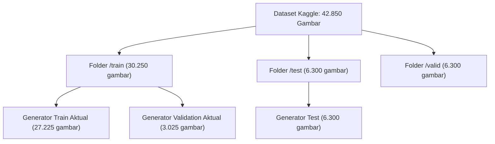
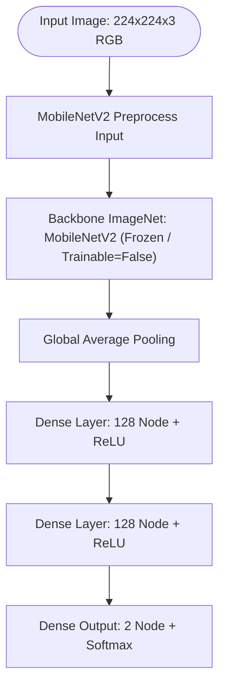
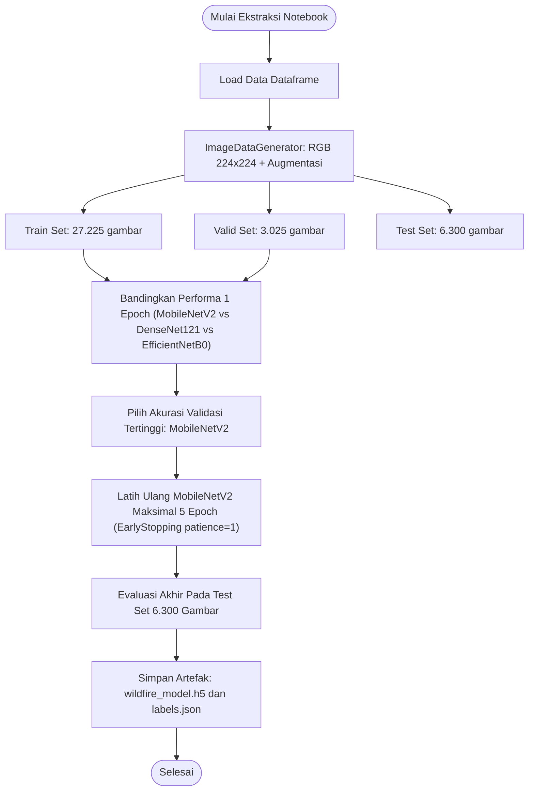
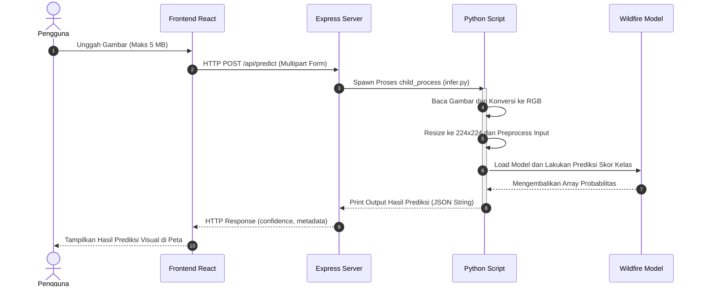

# Dokumentasi Training Model Klasifikasi Citra Wildfire

Dokumen ini adalah dokumentasi mandiri untuk model RGB yang dipakai endpoint `POST /api/predict`. Isinya direkonstruksi dari notebook Colab yang dibagikan melalui Google Drive publik dan dibandingkan dengan artefak yang ada di repository:

- Model deployment: [`backend/model/wildfire_model.h5`](../backend/model/wildfire_model.h5)
- Label deployment: [`backend/model/labels.json`](../backend/model/labels.json)
- Script inference: [`backend/python/infer.py`](../backend/python/infer.py)
- Endpoint backend: [`backend/server.js`](../backend/server.js)

Notebook sumber: [Colab training notebook](https://google.com). Notebook tidak disalin mentah ke repository karena salah satu cell-nya berisi credential Kaggle. Dokumentasi ini hanya memuat konfigurasi, hasil, dan penjelasan teknis yang relevan.

> **Status hasil:** angka di bawah adalah output notebook yang berhasil diekstrak, bukan hasil training ulang di mesin repository ini. Dataset sekitar 1,45 GB dan credential/dataset asli tidak disimpan di repository.

## 1. Tujuan model

Model melakukan klasifikasi dua kelas pada gambar RGB:

| Label | Arti |
|---|---|
| `wildfire` | Pola gambar lebih dekat dengan contoh kelas wildfire pada dataset |
| `nowildfire` | Pola gambar lebih dekat dengan contoh kelas nowildfire pada dataset |

Model **bukan** pendeteksi koordinat hotspot, bukan segmentasi api, dan bukan pengukur luas atau tingkat bahaya kebakaran. Hasilnya hanya bantuan screening visual dan harus dibandingkan dengan peta hotspot NASA FIRMS, waktu observasi, sumber lapangan, dan konteks cuaca.

## 2. Sumber dan pembagian data

Notebook mengunduh dataset Kaggle:
> `abdelghaniaaba/wildfire-prediction-dataset`

Struktur folder asli pada dataset:
```text
/content/dataset/
├── train/
│   ├── nowildfire/
│   └── wildfire/
├── valid/
│   ├── nowildfire/
│   └── wildfire/
└── test/
    ├── nowildfire/
    └── wildfire/
```

### Visualisasi Distribusi dan Split Data Aktual

Berikut adalah alur bagaimana data aktual dipecah secara internal menggunakan `ImageDataGenerator(validation_split=0.1)` di dalam generator final:


*Catatan: Folder `/valid` bawaan dataset asli tidak digunakan oleh generator final, melainkan digantikan oleh validation split internal dari folder `train`.*

## 3. Preprocessing dan augmentasi

Semua gambar diproses sebagai RGB dengan target ukuran `224 x 224` dan batch size `32`.
Preprocessing piksel menggunakan fungsi: `tf.keras.applications.mobilenet_v2.preprocess_input`.

**Parameter Augmentasi Data (Train & Validation):**
- `rotation_range=30`
- `zoom_range=0.15`
- `width_shift_range=0.2`
- `height_shift_range=0.2`
- `shear_range=0.15`
- `horizontal_flip=True`
- `fill_mode="nearest"`

*Generator test tidak menggunakan augmentasi dan diset `shuffle=False`.*

## 4. Arsitektur model

Arsitektur akhir menggunakan salah satu dari tiga backbone ImageNet yang dibekukan (`trainable=False`) dengan Custom Classification Head.



**Konfigurasi Compile:**
- **Optimizer:** Adam (Default Learning Rate Keras)
- **Loss Function:** `categorical_crossentropy`
- **Metric:** `accuracy`

## 5. Preview Alur Eksekusi & Training Pipeline



## 6. Hasil perbandingan backbone

Setiap kandidat terlebih dahulu dilatih selama satu epoch untuk menentukan performa baseline:

| Model | Validation accuracy setelah 1 epoch | Waktu training | Status |
|---|---:|---:|---|
| **MobileNetV2** | **0,9557** | **115,66 detik** | **Terpilih** |
| DenseNet121 | 0,9534 | 150,70 detik | Dieliminasi |
| EfficientNetB0 | 0,8555 | 125,07 detik | Dieliminasi |

## 7. Hasil training final

Model MobileNetV2 terpilih dilatih maksimal lima epoch. Pelatihan berhenti otomatis pada epoch keempat karena `val_loss` memburuk dan memicu fungsi `EarlyStopping`.

| Epoch | Train accuracy | Train loss | Validation accuracy | Validation loss | Catatan |
|---:|---:|---:|---:|---:|---|
| 1 | 0,9474 | 0,1397 | 0,9540 | 0,1288 | |
| 2 | 0,9626 | 0,1002 | 0,9574 | 0,1120 | |
| 3 | 0,9698 | 0,0799 | **0,9593** | **0,1071** | **Bobot Terbaik Dipulihkan** |
| 4 | 0,9744 | 0,0667 | 0,9547 | 0,1212 | Mengalami Overfitting |

## 8. Hasil evaluasi test

Evaluasi akhir pada 6.300 gambar test menghasilkan performa puncak:
```text
Best Model: MobileNetV2 with 97.00% accuracy on the test set
```

### Batasan Penting & Interpretasi Aman:
- Angka `97,00%` adalah akurasi di atas kertas pada test split dataset terkait.
- Angka ini **bukan** jaminan akurasi mutlak pada citra lokal satelit operasional atau kamera lapangan riil.
- Belum dilakukan proses validasi independen berbasis data lapangan konkrit di dalam repository ini.

## 9. Artefak model

Model disimpan dan didistribusikan ke dalam sistem produksi melalui struktur direktori berikut:

```text
backend/model/
├── wildfire_model.h5   # File bobot model hdf5 keras
└── labels.json         # Objek JSON pemetaan kelas {"0": "nowildfire", "1": "wildfire"}
```

## 10. Hubungan dengan Aplikasi (Alur Runtime)

Sequence diagram di bawah menunjukkan interaksi runtime saat pengguna mengirimkan permintaan inferensi gambar dari antarmuka frontend ke backend:


