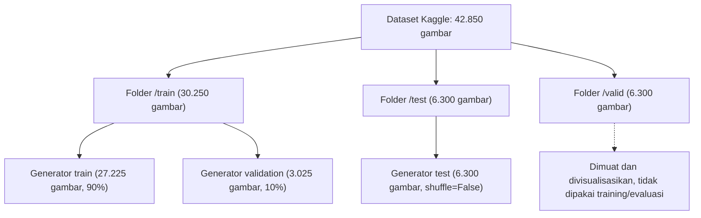
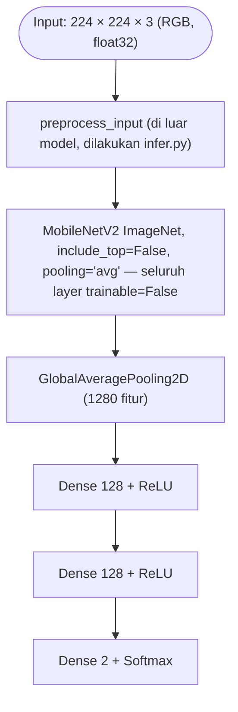
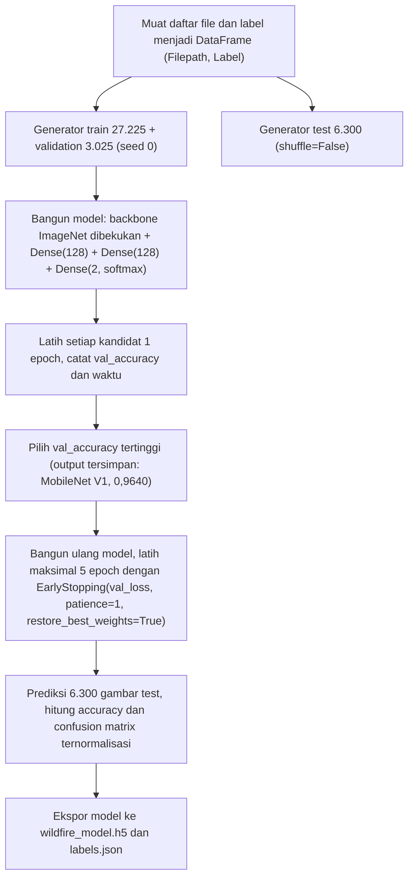
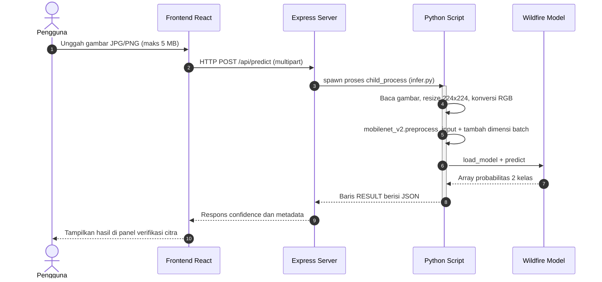

# Dokumentasi Training Model Klasifikasi Citra Wildfire

Dokumen ini menjelaskan model RGB yang dipakai endpoint `POST /api/predict`. Isinya diverifikasi ulang pada 20 Oktober 2026 dari empat sumber:

- Notebook sumber: `E:\Coding\wildfire-kaggle\wildfire-prediction-dataset-satellite-images (1).ipynb` (berada di luar repository; output yang tersimpan berasal dari run 10 Februari 2023).
- Artefak deployment: [`backend/model/wildfire_model.h5`](../backend/model/wildfire_model.h5) dan [`backend/model/labels.json`](../backend/model/labels.json), diperiksa langsung dengan `h5py`.
- Script inference: [`backend/python/infer.py`](../backend/python/infer.py).
- Endpoint backend: [`backend/server.js`](../backend/server.js).

> **Status hasil:** angka di dokumen ini berasal dari output notebook yang tersimpan dan pembacaan artefak, bukan training ulang di mesin repository. Dataset sekitar 1,44 GiB (1,55 GB) tidak disimpan di repository. Notebook memakai path Kaggle `../input/...`, sehingga harus dijalankan di Kaggle/Colab dengan dataset terpasang.

> **Catatan provenance (penting):** output notebook yang tersimpan memilih **MobileNet (V1)** sebagai model terbaik dan melaporkan test accuracy **97,86%** untuk model tersebut. Artefak yang dipakai aplikasi adalah **MobileNetV2**. State optimizer artefak MobileNetV2 konsisten dengan training 4 epoch pada split yang sama (`optimizer/iteration = 3404 = 851 batch × 4 epoch`), tetapi metrik per epoch dan metrik test-nya tidak tercatat di notebook. Karena itu angka 97,86% **tidak boleh** diklaim sebagai akurasi model yang dipakai aplikasi.

## 1. Tujuan model

Model melakukan klasifikasi dua kelas pada gambar RGB:

| Label | Arti |
|---|---|
| `wildfire` | Pola gambar lebih dekat dengan contoh kelas wildfire pada dataset |
| `nowildfire` | Pola gambar lebih dekat dengan contoh kelas nowildfire pada dataset |

Model **bukan** pendeteksi koordinat hotspot, bukan segmentasi api, dan bukan pengukur luas atau tingkat bahaya kebakaran. Hasilnya hanya bantuan screening visual dan harus dibandingkan dengan peta hotspot NASA FIRMS, waktu observasi, sumber lapangan, dan konteks cuaca.

## 2. Sumber dan pembagian data

Dataset diambil dari Kaggle:

> `abdelghaniaaba/wildfire-prediction-dataset` — *Wildfire Prediction Dataset (Satellite Images)*

| Properti | Nilai (metadata Kaggle) |
|---|---|
| Jenis citra | Citra satelit 350×350 piksel dari area yang pernah mengalami kebakaran di Kanada (Quebec), diekstrak memakai MapBox API |
| Jumlah citra | 42.850 gambar: 22.710 `wildfire` dan 20.140 `nowildfire` |
| Ukuran unduhan | 1.550.112.972 byte ≈ 1,44 GiB (1,55 GB desimal) |
| Lisensi | CC-BY 4.0 (data asal Quebec) |
| Jumlah kelas | 2 |

Struktur folder yang dibaca notebook (path Kaggle, bukan `/content/dataset`):

```text
../input/wildfire-prediction-dataset/
├── train/
│   ├── nowildfire/
│   └── wildfire/      # total 30.250 gambar
├── valid/
│   ├── nowildfire/
│   └── wildfire/      # total 6.300 gambar
└── test/
    ├── nowildfire/
    └── wildfire/      # total 6.300 gambar
```

### Pembagian data yang benar-benar dipakai

Notebook memuat ketiga folder ke DataFrame `(Filepath, Label)`, lalu membentuk generator dengan `ImageDataGenerator(validation_split=0.1, seed=0)`:



| Generator | Jumlah gambar | Keterangan |
|---|---:|---|
| Train | 27.225 | 90% dari folder `train`, `seed=0` |
| Validation | 3.025 | 10% dari folder `train`, `seed=0` |
| Test | 6.300 | Folder `test` terpisah, `shuffle=False` |
| Tidak terpakai | 6.300 | Folder `valid` bawaan dataset |

Total gambar yang benar-benar dipakai: 36.550 dari 42.850 (85,3%).

Urutan indeks kelas mengikuti abjad nama folder, sehingga `nowildfire` = 0 dan `wildfire` = 1. Urutan ini sama dengan isi [`labels.json`](../backend/model/labels.json): `{"0": "nowildfire", "1": "wildfire"}`.

**Batasan domain:** citra latih berasal dari Kanada, bukan Kalimantan. Model mempelajari tekstur dan warna citra satelit Kanada pada resolusi 350×350; tidak ada satu pun contoh negatif dari lanskap, kabut, atau lahan gambut Kalimantan. Kinerja pada citra lokal tidak dijamin dan belum diuji.

## 3. Preprocessing dan augmentasi

Semua gambar diproses sebagai RGB dengan target ukuran `224 × 224` dan batch size `32`.

```python
train_generator = tf.keras.preprocessing.image.ImageDataGenerator(
    preprocessing_function=tf.keras.applications.mobilenet_v2.preprocess_input,
    validation_split=0.1,
)
test_generator = tf.keras.preprocessing.image.ImageDataGenerator(
    preprocessing_function=tf.keras.applications.mobilenet_v2.preprocess_input,
)
```

Fungsi `mobilenet_v2.preprocess_input` mengubah nilai piksel `[0, 255]` menjadi rentang `[-1, 1]`. Fungsi ini dipakai baik saat training maupun saat inferensi.

### Augmentasi tidak pernah berjalan

Notebook **menuliskan** parameter augmentasi pada pemanggilan `flow_from_dataframe`:

```python
rotation_range=30, zoom_range=0.15,
width_shift_range=0.2, height_shift_range=0.2,
shear_range=0.15, horizontal_flip=True, fill_mode="nearest"
```

Namun `ImageDataGenerator.flow_from_dataframe` tidak memiliki parameter tersebut. Argumen itu masuk ke `**kwargs` dan diabaikan; fungsi hanya membaca `has_ext`, `sort`, dan `drop_duplicates` dari argumen tambahan. Akibatnya:

- Tidak ada rotasi, zoom, shift, shear, atau flip yang diterapkan.
- Training hanya memakai resize ke 224×224, konversi RGB, dan `preprocess_input`.
- Angka akurasi di dokumen ini adalah hasil training **tanpa augmentasi**.

Jangan mengklaim augmentasi sebagai bagian dari metode. Jika augmentasi ingin dipakai, parameter harus dipindahkan ke konstruktor `ImageDataGenerator(...)` atau memakai layer augmentasi di dalam model, lalu model dilatih ulang.

### Preprocessing saat prototype berjalan

Artefak `.h5` **tidak memiliki layer preprocessing di dalam graph** (158 layer, layer pertama langsung `Conv1`; tidak ada `Rescaling` atau `Normalization`). Karena itu `preprocess_input` wajib dilakukan di luar model. Implementasinya ada di [`backend/python/infer.py`](../backend/python/infer.py):

1. Baca file upload dan catat ukuran asli.
2. `resize((224, 224))`, lalu `convert("RGB")`.
3. `np.array(..., dtype=np.float32)` dan `mobilenet_v2.preprocess_input`.
4. Tambah dimensi batch menjadi `[1, 224, 224, 3]`.

Urutan ini sudah sesuai dengan training. Satu perbedaan kecil: generator Keras melakukan resize dengan interpolasi default `nearest`, sedangkan `PIL.Image.resize` memakai interpolasi default BICUBIC. Perbedaannya kecil, tetapi tetap merupakan sumber pergeseran distribusi yang perlu disebut sebagai keterbatasan.

## 4. Arsitektur model

Arsitektur yang benar-benar tersimpan di `wildfire_model.h5` adalah `Functional` dengan 158 layer:



| Bagian | Detail | Jumlah parameter |
|---|---|---:|
| Backbone | MobileNetV2 (alpha 1.0), bobot ImageNet, dibekukan | 2.257.984 |
| Head | `Dense(128, relu)` → `Dense(128, relu)` → `Dense(2, softmax)` | 180.738 |
| **Total** |  | **2.438.722** |

Konfigurasi compile yang tersimpan di artefak:

- **Optimizer:** Adam, learning rate `0.001` (default Keras).
- **Loss:** `categorical_crossentropy`.
- **Metrik:** `accuracy`.
- **Format simpan:** Keras 3.13.2, file HDF5 berisi konfigurasi, bobot, dan state optimizer.

Nama layer backbone (`Conv1`, `bn_Conv1`, `block_1_expand` … `block_16_project`, `Conv_1` 1280 filter, `out_relu`) adalah nama khas MobileNetV2, bukan MobileNetV1. Seluruh layer backbone memiliki `trainable=False`; hanya tiga layer `Dense` yang dilatih.

## 5. Alur training



Tidak ada tahap augmentasi pada diagram karena augmentasi memang tidak pernah aktif (lihat bagian 3).

## 6. Hasil perbandingan backbone

Notebook membandingkan **27 kandidat**, masing-masing dilatih **1 epoch** dengan split yang sama. Angka di bawah adalah output `df_results` yang tersimpan:

| Peringkat | Model | Validation accuracy | Waktu latih (detik) |
|---:|---|---:|---:|
| 1 | **MobileNet (V1)** | **0,9640** | 114,04 |
| 2 | DenseNet201 | 0,9636 | 152,46 |
| 3 | DenseNet169 | 0,9600 | 135,58 |
| 4 | DenseNet121 | 0,9590 | 276,70 |
| 5 | ResNet152V2 | 0,9577 | 152,78 |
| 6 | VGG16 | 0,9564 | 135,51 |
| 7 | ResNet50V2 | 0,9560 | 128,96 |
| 8 | ResNet101V2 | 0,9547 | 138,34 |
| 9 | **MobileNetV2** | **0,9544** | 118,69 |
| 10 | NASNetMobile | 0,9481 | 140,44 |
| 11 | VGG19 | 0,9464 | 128,02 |
| 12 | Xception | 0,9445 | 130,58 |
| 13 | InceptionResNetV2 | 0,9431 | 154,13 |
| 14 | InceptionV3 | 0,9398 | 131,33 |
| 15 | ResNet152 | 0,8863 | 158,81 |
| 16 | MobileNetV3Small | 0,8836 | 144,66 |
| 17 | ResNet50 | 0,8823 | 126,46 |
| 18 | ResNet101 | 0,8770 | 138,21 |
| 19 | MobileNetV3Large | 0,8648 | 117,44 |
| 20 | EfficientNetB7* | 0,8506 | 141,01 |
| 21 | EfficientNetB2 | 0,8469 | 130,78 |
| 22 | EfficientNetB6* | 0,8215 | 143,18 |
| 23 | EfficientNetB5* | 0,8155 | 140,26 |
| 24 | EfficientNetB3 | 0,8109 | 136,94 |
| 25 | EfficientNetB4 | 0,8010 | 148,21 |
| 26 | EfficientNetB0 | 0,6443 | 124,30 |
| 27 | EfficientNetB1 | 0,5736 | 130,72 |

Catatan kejujuran data:

- `MobileNet` adalah MobileNet **V1**, bukan MobileNetV2. Model inilah yang dipilih oleh baris `best_model = df_results.iloc[0]` pada output yang tersimpan.
- MobileNetV2 berada di peringkat 9 dengan selisih 0,0096 (kurang dari 1 poin persentase) dari peringkat pertama. Selisih sekecil itu pada satu epoch tidak cukup untuk menyimpulkan satu arsitektur lebih baik.
- Baris bertanda `*` (EfficientNetB5, B6, B7) tidak valid: dictionary pada notebook memetakan ketiganya ke konstruktor `EfficientNetB4`, sehingga yang dilatih ulang adalah B4.
- Kunci `MobileNetV2` ditulis dua kali di dictionary, sehingga entri pertama tertimpa. Jumlah kandidat unik 27, bukan 28.
- Judul grafik pada notebook berbunyi `Accuracy on the test set (after 1 epoch)`, padahal sumbu Y memakai `val_accuracy`. Label grafik itu keliru dan tidak boleh dikutip sebagai akurasi test.
- Perbandingan satu epoch hanya indikasi awal, bukan benchmark arsitektur yang adil, karena belum convergence dan belum diulang dengan beberapa seed.

## 7. Hasil training final

Setelah memilih model terbaik dari tabel di atas, notebook membangun ulang model dan melatihnya maksimal 5 epoch dengan `EarlyStopping(monitor='val_loss', patience=1, restore_best_weights=True)`.

Output yang tersimpan (model terpilih: **MobileNet V1**):

| Epoch | Train loss | Train accuracy | Validation loss | Validation accuracy | Catatan |
|---:|---:|---:|---:|---:|---|
| 1 | 0,1270 | 0,9531 | 0,0998 | 0,9617 | |
| 2 | 0,0903 | 0,9678 | 0,0842 | 0,9686 | |
| 3 | 0,0732 | 0,9716 | **0,0809** | **0,9696** | `val_loss` terbaik, bobot dipulihkan |
| 4 | 0,0604 | 0,9779 | 0,0943 | 0,9646 | `val_loss` memburuk, `EarlyStopping` menghentikan training |

### Artefak yang dipakai aplikasi

`backend/model/wildfire_model.h5` bukan model dari baris tabel di atas. Artefak itu adalah **MobileNetV2** dengan 2.438.722 parameter, dan state optimizer-nya menunjukkan `iteration = 3404`. Karena satu epoch berisi 851 batch (27.225 ÷ 32), angka itu konsisten dengan **4 epoch** training pada split yang sama. Metrik validation per epoch untuk artefak ini tidak tersimpan di notebook, sehingga tidak ada angka validation accuracy MobileNetV2 yang dapat dikutip untuk model deployment.

Kesimpulan yang aman: arsitektur deployment adalah MobileNetV2 hasil transfer learning yang konsisten dengan 4 epoch, tetapi kurva dan metrik validasinya belum tercatat.

## 8. Hasil evaluasi test

Output notebook yang tersimpan menghitung akurasi pada 6.300 gambar test memakai `accuracy_score`, lalu menampilkan:

```text
Best Model: MobileNet with 97.86% accuracy on the test set
```

Selain akurasi, notebook menampilkan **confusion matrix ternormalisasi** (gambar, bukan angka). `classification_report` sudah diimpor tetapi **tidak pernah dipanggil**, sehingga precision, recall, dan F1 per kelas tidak tersedia di output.

Yang perlu ditegaskan:

- Angka **97,86%** adalah test accuracy untuk **MobileNet V1**, bukan untuk MobileNetV2 yang dipakai aplikasi.
- Test accuracy artefak MobileNetV2 **belum diukur** dan tidak ada di repository. Angka 97,00% yang pernah ditulis di dokumen versi sebelumnya tidak didukung oleh sumber mana pun dan sudah dihapus.
- Angka ini berasal dari test split dataset Kanada yang distribusinya mirip dengan data latih. Angka tersebut bukan estimasi performa pada citra Kalimantan, kamera ponsel, atau kondisi berasap.
- Karena `classification_report` tidak dijalankan, klaim tentang keseimbangan precision/recall antar kelas juga belum punya dasar.

Untuk mendapatkan angka yang benar untuk model deployment, jalankan evaluasi pada folder `test` dengan preprocessing yang sama:

```python
import tensorflow as tf
from sklearn.metrics import accuracy_score, classification_report, confusion_matrix

model = tf.keras.models.load_model("backend/model/wildfire_model.h5")
test = tf.keras.utils.image_dataset_from_directory(
    "path/ke/wildfire-prediction-dataset/test",
    image_size=(224, 224), batch_size=32, shuffle=False,
)
test = test.map(lambda x, y: (tf.keras.applications.mobilenet_v2.preprocess_input(x), y))

y_true = [int(l) for _, batch in test for l in batch]
probs = model.predict(test, verbose=0)
y_pred = probs.argmax(axis=1)

print("accuracy:", accuracy_score(y_true, y_pred))
print(classification_report(y_true, y_pred, target_names=["nowildfire", "wildfire"]))
print(confusion_matrix(y_true, y_pred, normalize="true"))
```

`image_dataset_from_directory` mengurutkan nama folder secara abjad, sehingga indeks 0 = `nowildfire` dan 1 = `wildfire`, konsisten dengan `labels.json`.

## 9. Artefak model

```text
backend/model/
├── wildfire_model.h5   # model Keras lengkap: konfigurasi + bobot + state optimizer (11.745.904 byte)
└── labels.json         # pemetaan kelas {"0": "nowildfire", "1": "wildfire"}
```

Detail artefak:

| Properti | Nilai |
|---|---|
| Format | HDF5, Keras 3.13.2, backend TensorFlow |
| Isi | Model `Functional` utuh (`model_config` + `model_weights` + `optimizer_weights`), bukan file bobot saja |
| Input | `(None, 224, 224, 3)`, float32 |
| Output | `(None, 2)`, softmax |
| Jumlah layer | 158 |
| Jumlah parameter | 2.438.722 |
| Label di API | `model`: `wildfire_rgb_cnn` |

Karena file berisi model lengkap, `tf.keras.models.load_model()` dapat memuatnya tanpa mendefinisikan ulang arsitektur. Model dimuat ulang pada setiap permintaan `/api/predict`, sehingga latensi total sekitar 1,1 detik (muat model ±0,6 detik + inferensi ±0,5 detik).

## 10. Hubungan dengan aplikasi (alur runtime)



CNN hanya dipakai untuk verifikasi citra yang diunggah pengguna. Titik pada peta tetap berasal dari NASA FIRMS dan tidak dihasilkan oleh model ini.

## 11. Koreksi terhadap dokumentasi sebelumnya

| Klaim di versi lama | Temuan dari notebook dan artefak | Status |
|---|---|---|
| Augmentasi rotasi, zoom, shift, shear, flip aktif saat training | Parameter ditulis di `flow_from_dataframe` dan diabaikan; augmentasi tidak pernah berjalan | Diperbaiki |
| Perbandingan hanya MobileNetV2, DenseNet121, EfficientNetB0 | Notebook membandingkan 27 kandidat | Diperbaiki |
| MobileNetV2 unggul dengan val_accuracy 0,9557 | MobileNetV2 0,9544 (peringkat 9); peringkat 1 MobileNet V1 0,9640 | Diperbaiki |
| DenseNet121 0,9534 dan EfficientNetB0 0,8555 | Nilai sebenarnya 0,9590 dan 0,6443 | Diperbaiki |
| Riwayat training final 0,9474 → 0,9779 | Nilai sebenarnya 0,9531 → 0,9779, dan itu untuk MobileNet V1 | Diperbaiki |
| Test accuracy 97,00% untuk MobileNetV2 | Output notebook: 97,86% untuk MobileNet V1; metrik MobileNetV2 tidak tercatat | Diperbaiki |
| `wildfire_model.h5` adalah "file bobot" | File berisi model lengkap + state optimizer | Diperbaiki |
| Notebook sumber berupa tautan Google Drive | Notebook ada di `E:\Coding\wildfire-kaggle\...ipynb` dengan output run 2023 | Diperbaiki |
| Dataset bersifat "global dan umum" | Dataset adalah citra satelit Kanada (Quebec), 350×350 piksel | Diperbaiki |

## 12. Batasan dan klaim yang aman

1. Model hanya dua kelas dan hanya memakai citra RGB; tidak ada sensor termal, koordinat, atau informasi waktu.
2. Data latih berasal dari Kanada, bukan Kalimantan. Tidak ada validasi pada citra lokal.
3. Augmentasi tidak aktif, sehingga model lebih rentan terhadap variasi rotasi, skala, dan pencahayaan.
4. Backbone dibekukan; hanya head yang dilatih. Ini membatasi kapasitas adaptasi ke domain baru.
5. Perbandingan arsitektur hanya 1 epoch dan satu seed, sehingga belum cukup untuk klaim keunggulan arsitektur.
6. Metrik test artefak deployment (MobileNetV2) belum diukur; precision, recall, F1, dan kalibrasi juga belum.
7. Skor softmax belum dikalibrasi. Sebut sebagai "skor kemiripan", bukan probabilitas kejadian kebakaran.
8. Model dimuat ulang tiap permintaan sehingga latensi dan memori belum optimal.
9. Interpolasi resize saat training (`nearest`) dan inferensi (BICUBIC) berbeda; perbedaan kecil tetapi nyata.

Kalimat yang aman untuk presentasi:

> "Model yang dipakai adalah MobileNetV2 hasil transfer learning pada dataset citra satelit Kanada. Pada eksperimen pembanding yang tersimpan, MobileNetV2 mencapai validation accuracy 0,9544 setelah satu epoch. Metrik test untuk artefak yang diekspor belum kami ukur, jadi kami tidak mengklaim angka akurasi test untuk model produksi. Model ini hanya alat bantu screening, bukan pendeteksi kebakaran."