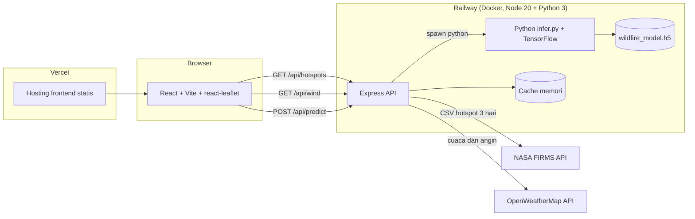
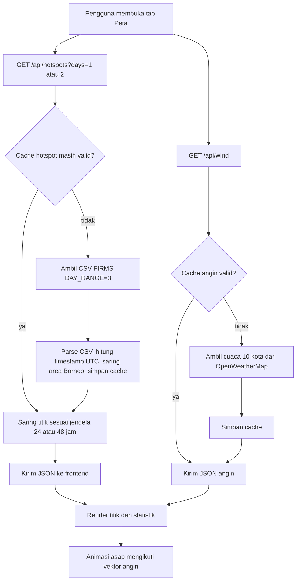
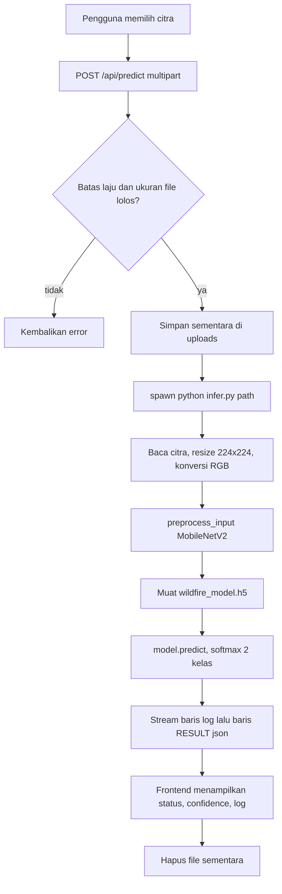

# PRD: Deteksi Dini Titik Panas (Hotspot) Potensi Karhutla di Kalimantan Berbasis Citra Satelit Menggunakan CNN

| Atribut | Nilai |
|---|---|
| Versi dokumen | 1.0 |
| Tanggal | 12 Oktober 2026 |
| Status produk | Prototype berjalan di hosting gratis |
| Pemilik | hissyam90 |
| Konteks | Project UTS mata kuliah Dasar Kecerdasan Artifisial (DKA), Universitas Mulawarman |
| Repositori | https://github.com/hissyam90/kalimantan-wildfire-hotspot-detection |
| Demo | https://kalimantan-wildfire.vercel.app |
| Backend | https://wildfire-app-private-production.up.railway.app |

Dokumen ini untuk pemilik proyek dan untuk AI atau developer lain yang melanjutkan pekerjaan. Panduan teknis operasional ada di `AGENTS.md`.

---

## 1. Ringkasan

Aplikasi WebGIS yang menampilkan titik panas satelit NASA FIRMS di Pulau Kalimantan secara hampir real-time, lengkap dengan animasi arah angin sebagai ilustrasi sebaran asap, statistik, serta cuaca dan arah angin dari 10 kota acuan. Aplikasi juga menyediakan fitur verifikasi citra: pengguna mengunggah citra, lalu model CNN (transfer learning MobileNetV2) mengklasifikasikannya sebagai `wildfire` atau `nowildfire`, disertai log proses backend yang asli.

## 2. Latar belakang dan masalah

- Karhutla di Kalimantan berulang setiap musim kemarau dan asapnya melintasi batas wilayah.
- Data titik panas satelit tersedia gratis, tetapi sulit dibaca orang awam tanpa visualisasi dan konteks (angin, kualitas udara).
- Tugas mata kuliah meminta penerapan CNN pada citra satelit dan prototype yang bisa didemonstrasikan.

## 3. Tujuan dan non-tujuan

### Tujuan

| ID | Tujuan |
|---|---|
| G1 | Menampilkan hotspot FIRMS untuk jendela 24, 48, dan 72 jam terakhir di seluruh Kalimantan |
| G2 | Memberi konteks cuaca dan arah angin di sekitar titik panas, serta kualitas udara per kota (F5) |
| G3 | Menyediakan verifikasi citra berbasis CNN dengan proses yang transparan |
| G4 | Memenuhi enam syarat dokumen UTS (lihat bagian 13) |

### Non-tujuan

- Memprediksi kebakaran di masa depan.
- Memodelkan dispersi asap secara fisik (animasi asap hanya ilustrasi berbasis vektor angin).
- Menjadi sistem peringatan resmi atau pengganti data BMKG, KLHK, atau BRIN.
- Autentikasi pengguna, basis data historis, dan dukungan perangkat mobile pada versi ini.

## 4. Pengguna dan skenario

| Pengguna | Skenario |
|---|---|
| Dosen penguji | Membuka demo, melihat peta, mengganti periode 24/48/72 jam, mengunggah citra ke verifikasi, membaca log proses |
| Mahasiswa atau peneliti | Memahami pipeline data, model, dan batasan sistem lewat repositori dan dokumen ini |
| Publik | Melihat sebaran titik panas dan kondisi cuaca di sekitarnya |

## 5. Ruang lingkup fitur dan status

| ID | Fitur | Status | Catatan |
|---|---|---|---|
| F1 | Peta hotspot interaktif (Leaflet, tile OSM) | Selesai | Marker digambar dengan canvas (`preferCanvas`) |
| F2 | Periode data 24 jam, 48 jam, dan 72 jam | Selesai | Jendela waktu bergeser, bukan hari kalender UTC |
| F3 | Animasi asap berbasis arah angin | Selesai | Ilustratif, maksimum 6000 partikel |
| F4 | Statistik ringkas: total observasi dan rincian per satelit | Selesai | Angka mengikuti filter yang aktif |
| F5 | Cuaca dan kualitas udara (AQI) per kota | Selesai | `CityConditions.jsx`: AQI, PM2.5, PM10, suhu, kelembapan, angin, pencarian kota |
| F6 | Verifikasi citra CNN dengan log proses nyata | Selesai | Log di-stream dari `infer.py` |
| F7 | Mode terang dan gelap | Selesai | |
| F8 | Navigasi touchpad (geser 2 jari) | Selesai | Mouse wheel tetap untuk zoom |
| F9 | Popup detail hotspot | Selesai | Data hotspot, wilayah acuan terdekat, suhu, kelembapan, cuaca, arah angin |
| F10 | Filter batas administrasi Indonesia | Backlog | Saat ini bounding box persegi |
| F11 | Riwayat dan tren hotspot | Backlog | Butuh penyimpanan (mis. Supabase) |
| F12 | CNN pada tile citra satelit di sekitar hotspot | Backlog | Menyambungkan CNN dengan titik di peta |
| F13 | Tampilan mobile | Backlog | README menyatakan belum didukung |
| F14 | Grafik pie keyakinan dan distribusi observasi per jam | Backlog | `recharts` sudah ada di `package.json` tetapi belum dipakai di `src/` |

## 6. Persyaratan fungsional

| ID | Persyaratan |
|---|---|
| FR-01 | Sistem mengambil hotspot VIIRS SNPP NRT dari NASA FIRMS untuk bounding box Kalimantan dan menyimpannya di cache memori (10 menit; 1 menit bila hasil kosong). |
| FR-02 | Endpoint `/api/hotspots?days=1` mengembalikan titik dalam 24 jam terakhir, `days=2` dalam 48 jam terakhir, dihitung dari `acq_date` dan `acq_time` (UTC). |
| FR-03 | Frontend menampilkan hanya titik pada periode terpilih, semuanya berwarna sama; jumlah titik 48 jam harus lebih besar atau sama dengan 24 jam. |
| FR-04 | Sistem mengambil cuaca (suhu, kelembapan, deskripsi, angin) untuk 10 kota acuan dari OpenWeatherMap dengan cache 10 menit. |
| FR-05 | [Rencana] AQI dihitung dengan skala AQI AS (EPA) revisi 2024 dari PM2.5 dan PM10, nilai tertinggi menjadi AQI akhir, disertai kategori dan polutan dominan. |
| FR-06 | [Rencana] Peta menampilkan lencana AQI di tiap kota; klik membuka kartu kota (AQI, kategori, PM2.5, PM10, saran kesehatan, cuaca). |
| FR-07 | [Rencana] Tab "Kualitas udara" menampilkan daftar kota terurut dari AQI terburuk; klik baris memindahkan peta ke kota tersebut dan membuka kartunya. |
| FR-08 | Animasi asap memakai vektor angin hasil interpolasi inverse-distance dari seluruh titik acuan; arah gerak asap berlawanan dengan arah asal angin. |
| FR-09 | Pengguna dapat mematikan animasi asap. |
| FR-10 | `POST /api/predict` menerima satu gambar (field `image`, maksimum 5 MB), menjalankan CNN, dan men-stream log proses diikuti satu baris `RESULT:<json>`. |
| FR-11 | Frontend menampilkan status, confidence, probabilitas per kelas, dan log proses secara real-time. |
| FR-12 | Kegagalan pengambilan data ditampilkan sebagai pesan dengan tombol coba lagi, bukan tampilan kosong. |

## 7. Persyaratan non-fungsional

| ID | Persyaratan |
|---|---|
| NFR-01 | Kunci API tidak boleh ada di kode atau riwayat git; disimpan sebagai environment variable. |
| NFR-02 | CORS hanya mengizinkan domain frontend produksi dan `http://localhost:5173`. |
| NFR-03 | `/api/predict` dibatasi 10 permintaan per menit per IP dan 5 MB per file. |
| NFR-04 | Jumlah panggilan OpenWeatherMap tidak melebihi 60 per menit (batas gratis); saat ini 10 panggilan per 10 menit. |
| NFR-05 | Peta tetap responsif pada sampai sekitar 11.000 titik (periode 48 jam) di laptop standar. |
| NFR-06 | Antarmuka berbahasa Indonesia, desain datar tanpa emoji dan tanpa gradient. |
| NFR-07 | Aplikasi harus berjalan di hosting gratis (Vercel untuk frontend, Railway untuk backend). |

## 8. Arsitektur sistem



Ringkasan komponen:

| Lapisan | Teknologi |
|---|---|
| Frontend | React 19, Vite 8, react-leaflet 5, Leaflet 1.9, Recharts 3, axios |
| Backend | Node.js 20, Express 5, multer, express-rate-limit, dotenv, axios |
| Inferensi | Python 3, TensorFlow/Keras, Pillow, NumPy (dipanggil lewat `child_process.spawn`) |
| Data eksternal | NASA FIRMS (VIIRS SNPP NRT), OpenWeatherMap (weather) |
| Hosting | Vercel (frontend), Railway via Docker (backend) |

## 9. Alur proses

### 9.1 Alur data peta



### 9.2 Alur verifikasi citra CNN



## 10. Sumber data dan API

| Sumber | Endpoint yang dipakai | Catatan |
|---|---|---|
| NASA FIRMS | `/api/area/csv/{MAP_KEY}/VIIRS_SNPP_NRT/{bbox}/{DAY_RANGE}` | Batas 5000 transaksi per 10 menit. `DAY_RANGE` berarti hari kalender UTC dari hari ini ke belakang, bukan 24 jam bergeser. Kolom penting: `latitude`, `longitude`, `bright_ti4`, `frp`, `confidence` (`l`, `n`, `h`), `acq_date`, `acq_time` (HHMM UTC), `daynight`, `satellite`. |
| OpenWeatherMap | `/data/2.5/weather` | Suhu, kelembapan, deskripsi cuaca, angin (`wind.deg` adalah arah asal angin). Deskripsi masih berbahasa Inggris (belum memakai `lang=id`). |
| OpenWeatherMap | `/data/2.5/air_pollution` | Belum dipakai. Rencana F5: konsentrasi PM2.5 dan PM10 dihitung menjadi AQI AS. |

Bounding box hotspot saat ini: barat 108, selatan -4.5, timur 119, utara 4. Batas utara 4.0 memotong sebagian Kalimantan Utara (Nunukan, Sebatik, Krayan). Area persegi ini juga memuat ujung timur Belitung, pesisir barat Sulawesi, Sarawak, Sabah, dan Brunei (lihat bagian 14).

Titik acuan cuaca: 10 kota (Pontianak, Singkawang, Ketapang, Palangka Raya, Sampit, Banjarmasin, Samarinda, Balikpapan, Tanjung Redeb, Tarakan) yang seluruhnya di pesisir atau dekat pesisir, sehingga medan angin di pedalaman hanya hasil interpolasi.

## 11. Metodologi AI

### 11.1 Data dan pra-pemrosesan (EDA)

- Dataset: Wildfire Prediction Dataset (Satellite Images) di Kaggle, dua kelas: `wildfire` dan `nowildfire`.
- Jumlah citra menurut log notebook: training 27.225, validasi 3.025, test 6.300.
- Daftar berkas dan label dimuat ke DataFrame (`Filepath`, `Label`), diacak, lalu dialirkan dengan `flow_from_dataframe`.
- Validasi diambil 10% dari data train (`validation_split=0.1`, `seed=0`); data test terpisah dan tidak diacak.
- Ukuran masukan 224x224 RGB, batch 32, normalisasi `mobilenet_v2.preprocess_input` (piksel ke rentang -1 sampai 1).
- Catatan terverifikasi: parameter augmentasi (`rotation_range`, `zoom_range`, dan lainnya) pada notebook ditulis di `flow_from_dataframe`. Fungsi itu hanya membaca `has_ext`, `sort`, dan `drop_duplicates` dari argumen tambahan, sehingga augmentasi tidak pernah berjalan pada pelatihan. Jangan mengklaim augmentasi di makalah.
- Folder `valid` (6.300 citra) hanya dimuat dan divisualisasikan, tidak dipakai untuk pelatihan maupun evaluasi. Total dataset 42.850 citra, yang terpakai 36.550.

### 11.2 Model

- Transfer learning: basis pretrained ImageNet (dibekukan, `include_top=False`, `pooling='avg'`), lalu `Dense(128, relu)` dua kali dan `Dense(2, softmax)`.
- Optimizer Adam, loss `categorical_crossentropy`, metrik `accuracy`.
- Seleksi arsitektur: **tiga** kandidat (MobileNetV2, DenseNet121, EfficientNetB0) masing-masing dilatih 1 epoch lalu dibandingkan dengan `val_accuracy`. MobileNetV2 terpilih dengan 0,9557, lalu dilatih ulang maksimal 5 epoch dengan `EarlyStopping(monitor='val_loss', patience=1, restore_best_weights=True)` dan berhenti di epoch ke-4.
- Artefak deployment: MobileNetV2 dengan 158 layer dan 2.438.722 parameter, seluruh backbone dibekukan. Rantai provenance terverifikasi: notebook menyimpan model berukuran 11.745.904 byte (output `ls -la`), dan berkas `backend/model/wildfire_model.h5` berukuran sama persis; `optimizer_weights/adam/iteration = 3404` sama dengan 851 batch x 4 epoch; `labels.json` (36 byte) berisi `{"0": "nowildfire", "1": "wildfire"}`.
- Catatan pembanding: ada notebook lain dengan 27 backbone yang memilih MobileNet V1 (0,9640) dan melaporkan 97,86%. Notebook itu **bukan** sumber artefak dan angkanya tidak dipakai di dokumen ini.

### 11.3 Inferensi di produksi

`backend/python/infer.py` membaca citra, melakukan resize dan normalisasi yang identik dengan pelatihan, memuat model, memprediksi, lalu mencetak log dan satu baris `RESULT:` berisi JSON. Model dimuat ulang pada setiap permintaan.

### 11.4 Hubungan CNN dengan peta

Titik di peta berasal dari FIRMS, bukan dari CNN. CNN dipakai sebagai alat verifikasi citra yang diunggah pengguna. Menyambungkan keduanya (CNN pada tile citra di sekitar hotspot) adalah F12 di backlog.

## 12. Evaluasi dan metrik

### 12.1 Perbandingan arsitektur (1 epoch, `val_accuracy`)

| Model | val_accuracy | Waktu latih (detik) |
|---|---|---|
| **MobileNetV2** (terpilih) | **0,9557** | 115,66 |
| DenseNet121 | 0,9534 | 150,70 |
| EfficientNetB0 | 0,8555 | 125,07 |

Catatan: angka di atas adalah `val_accuracy` setelah 1 epoch pada 3.025 citra validasi, bukan akurasi test. Judul grafik pada notebook ("Accuracy on the test set") tidak sesuai dengan kolom yang digambar. Selisih MobileNetV2 dan DenseNet121 hanya 0,0023 (sekitar 7 citra), sehingga keunggulan yang meyakinkan adalah **efisiensi**, bukan akurasi. Perbandingan juga bias ke MobileNetV2 karena semua kandidat memakai `mobilenet_v2.preprocess_input`, padahal EfficientNetB0 mengharapkan skala 0-255 dengan normalisasi internalnya sendiri.

Riwayat pelatihan final MobileNetV2 (maksimal 5 epoch, berhenti di epoch 4):

| Epoch | Train accuracy | Val accuracy | Val loss |
|---|---|---|---|
| 1 | 0,9474 | 0,9540 | 0,1288 |
| 2 | 0,9626 | 0,9574 | 0,1120 |
| 3 | 0,9698 | **0,9593** | **0,1071** (terbaik) |
| 4 | 0,9744 | 0,9547 | 0,1212 |

`restore_best_weights=True` memulihkan bobot ke epoch 3, sehingga model yang disimpan adalah bobot epoch terbaik.

### 12.2 Metrik pada test set

| Metrik | Status |
|---|---|
| Accuracy test (6.300 citra) | **97,00%** untuk MobileNetV2 (6.111 benar, 189 salah) |
| Confusion matrix ternormalisasi | Ada, tetapi hanya berupa gambar; angkanya tidak dicetak sebagai teks |
| Precision, recall, F1 per kelas | Belum ada; `classification_report` diimpor tetapi tidak pernah dijalankan |
| ROC/AUC dan kalibrasi skor | Belum ada |
| Evaluasi folder `valid` | Belum pernah dihitung |

Angka 97,00% sah untuk artefak deployment karena evaluasi test dijalankan pada objek model yang bobotnya sudah dipulihkan ke epoch terbaik, dan objek yang sama itulah yang disimpan ke `wildfire_model.h5`. Angka 97,86% milik MobileNet V1 dari notebook pembanding dan tidak boleh dikutip untuk model aplikasi.

### 12.3 Metrik operasional (dari log backend)

| Metrik | Nilai teramati |
|---|---|
| Waktu muat model | sekitar 0,6 detik |
| Waktu inferensi | sekitar 0,46 sampai 0,49 detik |
| Total waktu proses | sekitar 1,07 sampai 1,13 detik |

## 13. Pemetaan ke syarat UTS

Presentasi UTS: 12 Oktober 2026. Makalah dikumpulkan paling lambat 16 Oktober 2026 (subjek: DKA).

| No | Syarat dosen | Bahan di proyek | Status |
|---|---|---|---|
| 1 | EDA dan pra-pemrosesan data | Notebook Colab dan bagian 11.1 | Siap; catatan augmentasi tidak aktif wajib disebut |
| 2 | Arsitektur sistem | Bagian 8 | Draft siap |
| 3 | Flowchart | Bagian 9 | Draft siap |
| 4 | Pseudocode atau algoritma | Lampiran A | Draft siap |
| 5 | Metrik evaluasi | Bagian 12 | Accuracy test 97,00% dan confusion matrix ada; precision/recall/F1 belum |
| 6 | Model atau prototype | Website live dan repositori | Selesai |

## 14. Keterbatasan dan risiko

1. Hotspot adalah anomali panas satelit, bukan kebakaran terkonfirmasi. Titik di laut biasanya suar gas anjungan migas atau pantulan matahari (sun glint).
2. Pengambilan area memakai persegi panjang, sehingga titik di Sarawak, Sabah, dan Brunei ikut terhitung pada "Total titik panas".
3. Data NRT diproses sekitar 3 jam setelah satelit lewat dan satelit hanya lewat sekitar dua kali sehari (sekitar 05-06 UTC dan 17-18 UTC di Kalimantan), jadi data bersifat hampir real-time, bukan instan.
4. Animasi asap adalah ilustrasi dari vektor angin permukaan yang diinterpolasi dari sedikit titik acuan, bukan model dispersi atmosfer.
5. AQI adalah estimasi dari konsentrasi saat ini, sedangkan skala EPA aslinya memakai rata-rata 24 jam. Nilainya dapat berbeda dari ISPU resmi.
6. Dataset pelatihan adalah citra satelit Kanada (Quebec) berukuran 350x350 piksel, bukan citra Kalimantan; tidak ada validasi pada citra lokal.
7. Model dimuat ulang pada setiap permintaan prediksi; ini menambah latensi dan memori.
8. Cache berada di memori satu instance; restart server mengosongkannya.
9. Hosting gratis memiliki sumber daya terbatas; aplikasi belum dirancang untuk mobile.
10. Augmentasi tidak pernah aktif karena parameternya ditulis di `flow_from_dataframe` dan diabaikan sebagai `**kwargs`.
11. Konversi ONNX gagal pada konflik versi Protobuf, sehingga backend harus memakai Python dan TensorFlow di dalam kontainer.
12. Skor softmax belum dikalibrasi; confidence tidak boleh disebut probabilitas kebakaran.

## 15. Backlog prioritas

| Prioritas | Item |
|---|---|
| P0 | **Cabut dan ganti token Kaggle** `KGAT_...` yang tertulis terbuka di cell 0 notebook Colab, lalu pindahkan ke Colab Secrets |
| P0 | Rotasi kunci API (FIRMS dan OpenWeatherMap) yang pernah muncul di tangkapan layar atau percakapan |
| P0 | Hitung precision, recall, F1 per kelas dan cetak confusion matrix sebagai angka |
| P1 | Aktifkan augmentasi dengan memindahkan parameter ke konstruktor `ImageDataGenerator` atau memakai layer augmentasi |
| P1 | Pakai folder `valid` (6.300 citra) sebagai uji independen |
| P1 | Simpan model sebagai `.keras` dan perbaiki konversi ONNX (pin versi Protobuf) |
| P1 | Fitur kualitas udara per kota (F5): endpoint stasiun, AQI dari PM2.5 dan PM10, lencana di peta, tab daftar kota |
| P1 | Perbaiki bounding box (utara 4.5, barat 108.5) dan tambah titik acuan angin di pedalaman |
| P1 | Tambahkan `app.set('trust proxy', 1)` di server.js agar batas laju dihitung per IP pengguna, bukan per proxy Railway |
| P1 | Rapikan README (Tailwind tidak dipakai, port lokal 5000, backend Node.js + Express) dan hapus `frontend/.vade-report` |
| P1 | Filter hotspot ke batas administrasi Indonesia memakai GeoJSON provinsi |
| P1 | Pisahkan inferensi menjadi layanan yang memuat model sekali (FastAPI atau ONNX Runtime) |
| P1 | Tambahkan `fileFilter` multer (hanya jpg/png) dan respons error JSON yang jelas |
| P2 | Hitung ISPU (skala Indonesia) selain AQI AS |
| P2 | Riwayat harian jumlah hotspot dan AQI (Supabase atau sejenis) |
| P2 | CNN pada tile citra satelit (mis. NASA GIBS) di sekitar hotspot |
| P3 | Tampilan mobile, uji otomatis, dan CI |

## 16. Definisi selesai (versi UTS)

- Demo live dapat dibuka tanpa server lokal menyala.
- Periode 24 jam dan 48 jam sama-sama menampilkan data dan 48 jam memuat lebih banyak titik.
- Verifikasi citra menampilkan log proses lalu hasil klasifikasi.
- Repositori publik tidak berisi kunci API.
- Dokumen syarat 1-5 tersusun di makalah.

---

## Lampiran A. Pseudocode

### A.1 Pipeline data dan pelatihan

```
ALGORITMA LatihKlasifikasiKarhutla
MASUKAN : folder dataset (train, test), kelas {nowildfire, wildfire}
KELUARAN: wildfire_model.h5, labels.json

1. UNTUK setiap folder, baca daftar berkas gambar dan labelnya menjadi tabel (Filepath, Label)
2. Acak urutan baris tabel train
3. Bentuk generator:
     train      = 90% tabel train, ukuran 224x224 RGB, batch 32, preprocess_input
     validasi   = 10% tabel train, perlakuan sama
     test       = tabel test, tanpa diacak
4. UNTUK setiap arsitektur kandidat A:
     bangun model = A (bobot ImageNet, dibekukan) + Dense(128) + Dense(128) + Dense(2, softmax)
     latih 1 epoch, catat val_accuracy dan waktu latih
5. Pilih A dengan val_accuracy tertinggi
6. Bangun ulang model dari A, latih maksimal 5 epoch dengan EarlyStopping(val_loss)
7. Prediksi data test, hitung akurasi dan confusion matrix
8. Simpan model ke wildfire_model.h5 dan peta indeks-kelas ke labels.json
```

### A.2 Inferensi satu citra

```
ALGORITMA PrediksiCitra
MASUKAN : path gambar
KELUARAN: label, confidence, probabilitas tiap kelas

1. gambar <- baca(path); catat ukuran asli
2. gambar <- resize(gambar, 224x224) lalu konversi ke RGB
3. x <- preprocess_input(array float32 dari gambar)
4. x <- tambah dimensi batch
5. model <- muat(wildfire_model.h5); labels <- muat(labels.json)
6. p <- model.predict(x)
7. i <- indeks nilai terbesar pada p
8. KEMBALIKAN label = labels[i], confidence = p[i], probabilitas = semua p
```

### A.3 Jendela waktu hotspot

```
ALGORITMA HotspotJendelaWaktu
MASUKAN : days (1 atau 2)
KELUARAN: daftar titik pada 24 atau 48 jam terakhir

1. JIKA cache valid MAKA baris <- cache
   SELAIN ITU baris <- ambil FIRMS(DAY_RANGE = 3); hitung ts = UTC(acq_date, acq_time) tiap baris; simpan cache
2. jam <- 24 * days
3. awal <- sekarang - jam
4. KEMBALIKAN semua baris dengan ts >= awal
```

### A.4 AQI per kota (rencana, F5)

```
ALGORITMA HitungAQI
MASUKAN : pm25, pm10 (konsentrasi saat ini)
KELUARAN: aqi, kategori, polutan dominan

1. pm25 <- potong ke 1 desimal; pm10 <- potong ke bilangan bulat
2. UNTUK setiap polutan, cari baris breakpoint [Clo, Chi, Ilo, Ihi] yang memuat nilainya
     indeks <- (Ihi - Ilo) / (Chi - Clo) * (nilai - Clo) + Ilo, dibulatkan
3. aqi <- maksimum(indeks PM2.5, indeks PM10); dominan <- polutan pemilik nilai maksimum
4. kategori <- Baik (0-50), Sedang (51-100), Tidak sehat bagi kelompok sensitif (101-150),
               Tidak sehat (151-200), Sangat tidak sehat (201-300), Berbahaya (301+)
```

## Lampiran B. Istilah

| Istilah | Arti |
|---|---|
| Hotspot | Piksel satelit dengan anomali panas yang terdeteksi sebagai potensi api |
| FRP | Fire Radiative Power, daya radiatif api dalam megawatt |
| NRT | Near Real-Time, data yang diproses beberapa jam setelah satelit lewat |
| VIIRS | Sensor satelit Suomi NPP untuk deteksi api |
| AQI | Air Quality Index; di sini skala AS (EPA) revisi 2024 |
| PM2.5 / PM10 | Partikel udara berdiameter di bawah 2,5 / 10 mikrometer |
| ISPU | Indeks Standar Pencemar Udara, skala resmi Indonesia |
