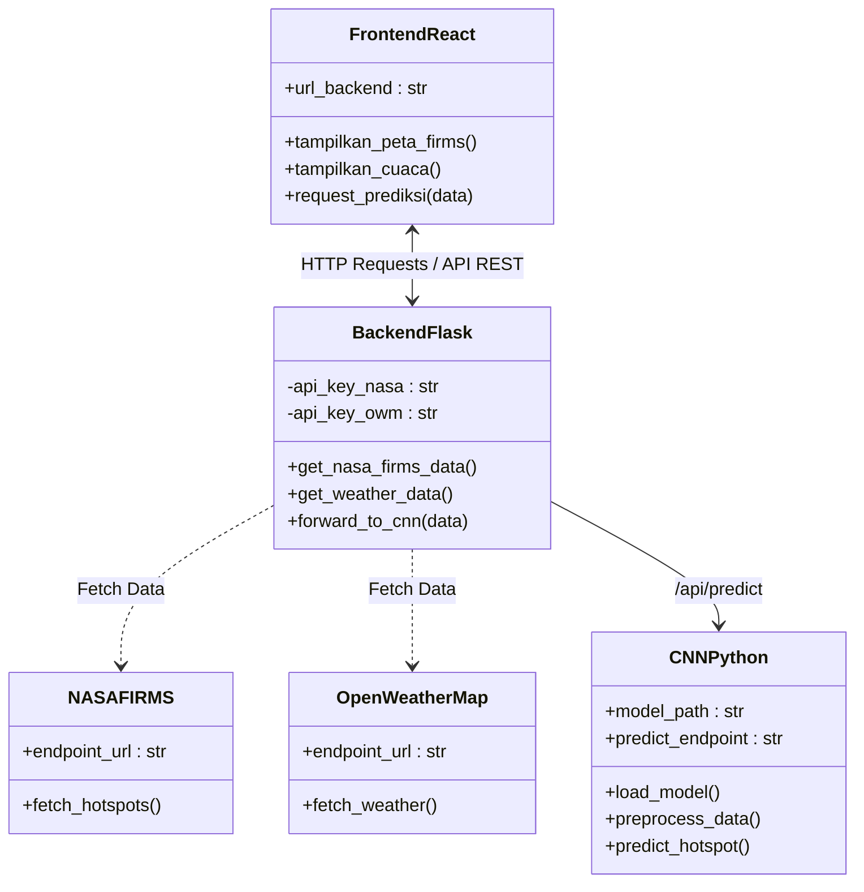

# Pantau Karhutla Kalimantan

## Panduan presentasi proyek

Dokumen ini menjadi acuan singkat untuk menjelaskan tujuan, cara kerja, sumber data, hasil yang ditampilkan, dan batasan aplikasi kepada dosen atau penguji.

Naskah bicara per poin syarat UTS (1-6) tersedia di [NASKAH_PRESENTASI.md](NASKAH_PRESENTASI.md), termasuk **peta alt-tab** di bagian A yang menunjukkan jendela dan tab mana yang dibuka pada setiap poin. Rincian teknis pelatihan ada di [MODEL_TRAINING.md](MODEL_TRAINING.md).

---

## 1. Gagasan utama

**Pantau Karhutla Kalimantan** adalah aplikasi web untuk membantu pengguna melihat tiga jenis informasi yang saling melengkapi:

1. **Peta hotspot**: lokasi observasi panas dari satelit NASA FIRMS.
2. **Kondisi kota**: cuaca dan AQI dari WAQI di 23 kota pantauan Kalimantan.
3. **Verifikasi citra**: bantuan klasifikasi gambar menggunakan CNN dua kelas.

Aplikasi ini bukan sistem pemadam kebakaran dan bukan pengganti laporan resmi. Tujuannya adalah membuat informasi awal lebih mudah dibaca serta membantu pengguna menentukan informasi apa yang perlu diperiksa berikutnya.

## 2. Masalah yang ingin dibantu

Informasi karhutla sering tersebar di beberapa sumber dan memakai istilah teknis yang sulit dipahami pengguna umum. Selain itu, titik panas satelit, kualitas udara, dan klasifikasi gambar sering keliru dianggap sebagai satu data yang sama.

Proyek ini memisahkan ketiganya secara jelas:

- **NASA FIRMS** menjawab: "Di mana satelit mendeteksi titik panas?"
- **OpenWeatherMap** membantu menjawab: "Bagaimana konteks cuaca dan angin di sekitar kota?"
- **WAQI** menyediakan AQI dan data partikulat dari stasiun terdekat; stasiun tidak selalu berada tepat di pusat kota.
- **CNN** menjawab: "Apakah pola pada gambar lebih mirip contoh area terbakar atau tidak?"

## 3. Fitur aplikasi

### A. Peta hotspot

- Menampilkan observasi NASA FIRMS VIIRS untuk wilayah Kalimantan.
- Pengguna dapat memilih rentang 24 atau 48 jam.
- Sidebar menampilkan jumlah titik, observasi terbaru, rentang waktu, dan sumber data.
- Klik titik untuk melihat koordinat, waktu pengamatan, dan satelit yang digunakan.
- NOAA-20 dan NOAA-21 adalah satelit berbeda. Waktu lintasan dan cakupannya berbeda, jadi jumlah observasi N20 dan N21 tidak harus sama; angka tersebut bukan jumlah kebakaran unik.
- Animasi asap adalah **ilustrasi arah pergerakan berdasarkan data angin**, bukan peta konsentrasi asap yang terukur.

### B. Kondisi kota

Kartu kota menampilkan suhu, deskripsi cuaca, kelembapan, kecepatan angin, AQI WAQI, PM2.5, dan PM10.

AQI pada kartu berasal dari **WAQI**. Cuaca dan angin tetap berasal dari OpenWeatherMap.

Titik pantauan yang digunakan adalah Pontianak, Singkawang, Ketapang, Palangkaraya, Sampit, Banjarmasin, Banjarbaru, Pangkalan Bun, Muara Teweh, Samarinda, Balikpapan, Bontang, Tenggarong, Tanjung Redeb, Tarakan, Tanjung Selor, dan Nunukan. Daftar ini mencakup ibu kota lima provinsi Kalimantan serta beberapa kota/kawasan penting lainnya; bukan daftar seluruh kota di pulau Kalimantan.

### C. Verifikasi citra

- Pengguna mengunggah gambar JPG/PNG.
- Backend mengubah ukuran dan memproses gambar dengan model CNN.
- Hasil ditampilkan sebagai dua kemungkinan: "terlihat seperti area terbakar" atau "tidak terlihat seperti area terbakar".
- Skor adalah tingkat kecocokan terhadap data latihan dan belum tentu terkalibrasi sebagai probabilitas.
- Hasil tidak memberikan koordinat, luas api, tingkat bahaya, atau kepastian bahwa api benar-benar ada.

### Fokus presentasi: model, prototype, dan pra-pemrosesan

Bagian CNN yang terhubung ke prototype adalah **model klasifikasi RGB berbasis MobileNetV2** yang disimpan sebagai `backend/model/wildfire_model.h5`. Model ini menerima satu gambar dan memilih salah satu dari dua label: `wildfire` atau `nowildfire`.

Notebook pelatihan membandingkan **tiga** arsitektur selama satu epoch: MobileNetV2, DenseNet121, dan EfficientNetB0. MobileNetV2 terpilih dengan `val_accuracy` **0,9557**, lalu dilatih ulang dan berhenti di epoch keempat dengan `val_accuracy` terbaik **0,9593**. Evaluasi pada test set menghasilkan **97,00%** untuk MobileNetV2. Angka itu sah untuk artefak yang dipakai aplikasi, karena evaluasi dilakukan pada model yang bobotnya sudah dipulihkan ke epoch terbaik — objek model yang sama kemudian disimpan sebagai `wildfire_model.h5`.

Yang perlu disampaikan dengan jujur: selisih MobileNetV2 dengan DenseNet121 hanya 0,0023, dan perbandingan itu memakai fungsi normalisasi MobileNetV2 untuk semua kandidat sehingga bias ke MobileNetV2. Precision, recall, dan F1 per kelas belum diukur.

Alur pra-pemrosesan pada saat inferensi adalah:

1. Frontend mengirim gambar JPG/PNG melalui `POST /api/predict` dengan batas ukuran 5 MB.
2. Backend menyimpan file sementara dan menjalankan `backend/python/infer.py`.
3. Gambar dibaca, diubah ke RGB, lalu di-resize menjadi `224 x 224` piksel.
4. Nilai piksel diproses dengan `tf.keras.applications.mobilenet_v2.preprocess_input`, kemudian ditambah dimensi batch menjadi `[1, 224, 224, 3]`.
5. Model menghasilkan skor untuk dua kelas. Label dengan skor terbesar ditampilkan bersama confidence, margin skor, ukuran asli gambar, jumlah parameter, dan waktu inferensi.

Saat menjelaskan hasil, gunakan kalimat **"skor kemiripan terhadap pola pada data latihan"**, bukan "probabilitas pasti terjadi kebakaran". Confidence dari softmax belum dikalibrasi.

> **Catatan penting agar tidak tertukar:** folder `training/` berisi baseline CNN patch termal VIIRS yang lebih baru untuk penelitian. Pipeline tersebut sudah memiliki validasi manifest, split berbasis group, dan metrik test, tetapi belum terhubung ke `/api/predict` dan belum memiliki hasil training lapangan yang boleh diklaim sebagai model prototype.

## 4. Sumber data dan alur sistem



Endpoint utama:

| Endpoint | Kegunaan |
|---|---|
| `GET /api/hotspots` | Mengambil dan menyaring observasi NASA FIRMS |
| `GET /api/wind` | Mengambil cuaca dan Air Pollution API OpenWeatherMap |
| `POST /api/predict` | Memproses gambar melalui model CNN |
| `GET /api/model-status` | Memeriksa kesiapan model |

Backend menyimpan cache sementara agar aplikasi tidak meminta data eksternal berulang kali pada setiap pemuatan halaman.

## 5. Cara membaca hasil dengan benar

Urutan penggunaan yang disarankan:

1. Buka **Peta hotspot** untuk melihat lokasi dan waktu observasi.
2. Buka **Kondisi kota** untuk melihat konteks cuaca dan partikulat di kota-kota sekitar.
3. Jika memiliki gambar, gunakan **Verifikasi citra** sebagai pemeriksaan tambahan.
4. Bandingkan waktu, lokasi, cuaca, dan sumber resmi sebelum menyimpulkan adanya kebakaran.

Contoh kalimat yang aman saat presentasi:

> "Aplikasi ini tidak menyatakan bahwa setiap titik adalah kebakaran. Sistem menggabungkan observasi satelit, konteks cuaca dan udara, serta klasifikasi citra agar pengguna memiliki dasar pemeriksaan awal yang lebih jelas."

## 6. Batasan penelitian

- NASA FIRMS adalah observasi satelit, bukan pengukuran langsung dari lapangan.
- Satu titik panas tidak menjelaskan ukuran api, penyebab, atau tingkat bahayanya.
- Data OpenWeatherMap bersifat regional pada koordinat kota dan tidak menggantikan stasiun pemantauan kualitas udara.
- WAQI diintegrasikan untuk 17 titik pantauan, tetapi ketersediaan stasiun dan kuota API dapat membuat sebagian AQI tidak tersedia.
- Model produksi masih memiliki dua kelas: `wildfire` dan `nowildfire`.
- Dataset latih adalah citra satelit Kanada (Quebec, 350x350), bukan lanskap Kalimantan. Model sah sebagai demonstrasi metode, bukan alat operasional.
- Augmentasi tidak aktif pada pelatihan, sehingga model lebih rentan terhadap variasi rotasi dan pencahayaan.
- Precision, recall, dan F1 per kelas belum diukur; hanya accuracy dan confusion matrix.
- Folder `valid` berisi 6.300 citra berlabel yang belum dipakai sebagai uji independen.
- Animasi asap pada peta hanya visualisasi arah angin, bukan simulasi dispersi atmosfer.

## 7. Konfigurasi dan demo lokal

Backend membutuhkan environment variable:

```env
FIRMS_KEY=...
OWM_KEY=...
WAQI_KEY=...
PYTHON_BIN=python
```

Jalankan backend:

```powershell
cd backend
python app.py
```

Jalankan frontend pada terminal lain:

```powershell
cd frontend
npm install
npm run dev
```

## 8. Alur demo

1. Tunjukkan tab **Peta hotspot** dan ubah periode 24/48 jam.
2. Klik satu titik dan jelaskan bahwa data berasal dari observasi NASA FIRMS.
3. Tunjukkan animasi asap, lalu tekankan bahwa itu ilustrasi arah angin.
4. Buka **Kondisi kota** dan jelaskan bahwa AQI berasal dari WAQI, sedangkan cuaca dan angin berasal dari OpenWeatherMap.
5. Buka **Verifikasi citra**, unggah satu gambar, lalu jelaskan hasil CNN sebagai bantuan awal.
6. Tutup dengan batasan sistem dan rencana validasi model.

Perpindahan jendela dan tab untuk setiap langkah demo di atas diatur di [NASKAH_PRESENTASI.md §A](NASKAH_PRESENTASI.md#a-peta-alt-tab-jendela-mana-tab-mana-tunjuk-apa).

## 9. Pengembangan berikutnya

- Mencabut token API Kaggle yang sempat tertulis di cell notebook, lalu memindahkannya ke Colab Secrets.
- Mengaktifkan augmentasi dengan benar (parameter dipindah ke konstruktor generator).
- Evaluasi precision, recall, F1-score, confusion matrix dalam bentuk angka, dan kalibrasi skor.
- Memakai folder `valid` (6.300 citra) sebagai uji independen.
- Menyimpan model dalam format native `.keras` dan memperbaiki konversi ONNX yang gagal karena konflik versi Protobuf.
- Pengujian model pada citra Kalimantan dengan pemisahan train/validation/test yang independen.
- Integrasi sumber kualitas udara resmi dengan lisensi dan API key yang sah.
- Penambahan riwayat grafik PM2.5 dan PM10.
- Validasi visual dengan petugas atau data lapangan sebelum digunakan untuk keputusan operasional.
